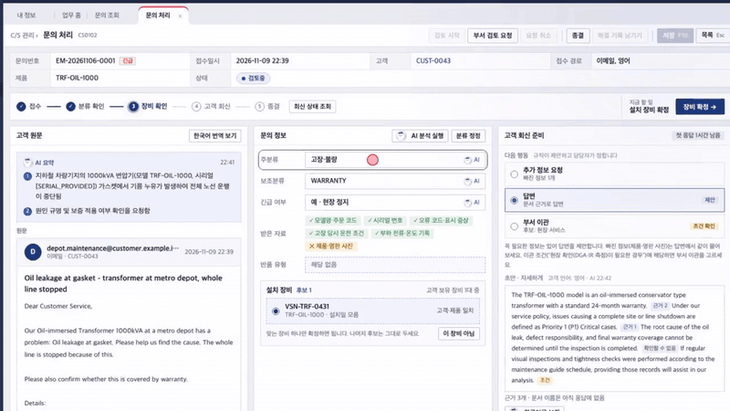
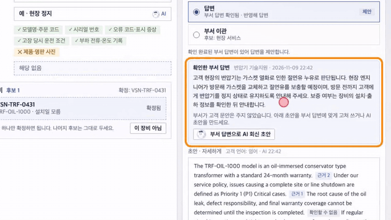
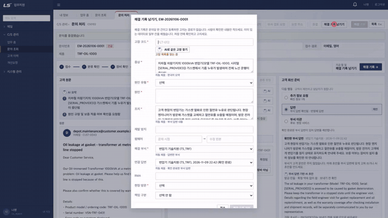
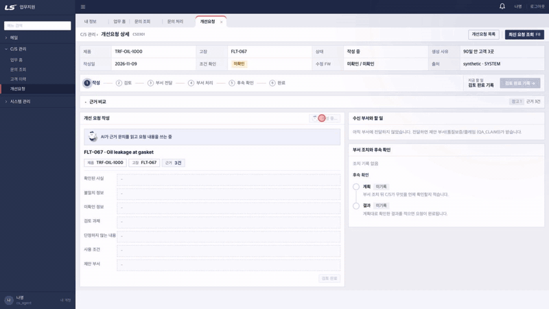
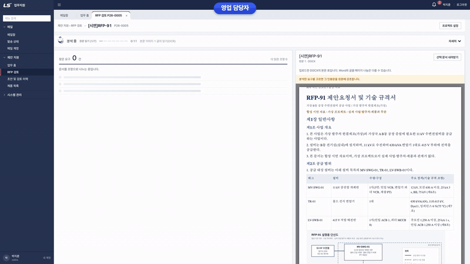
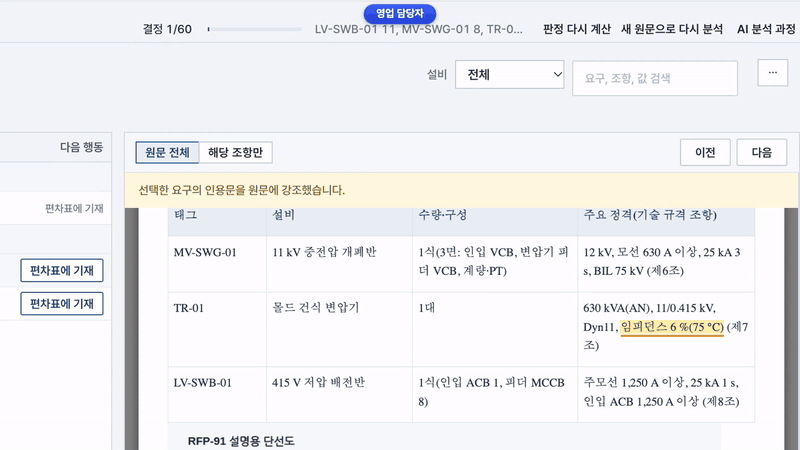
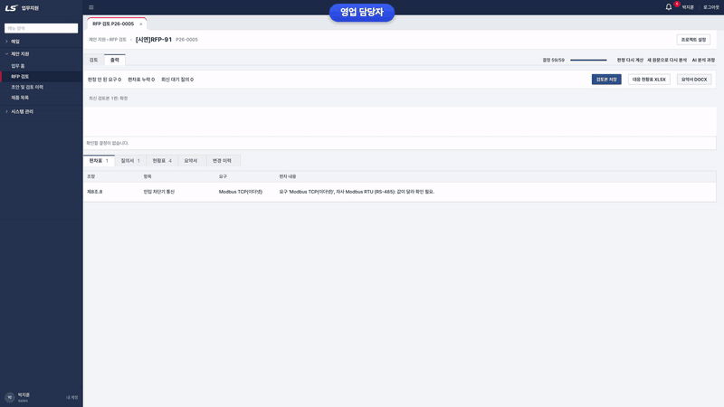
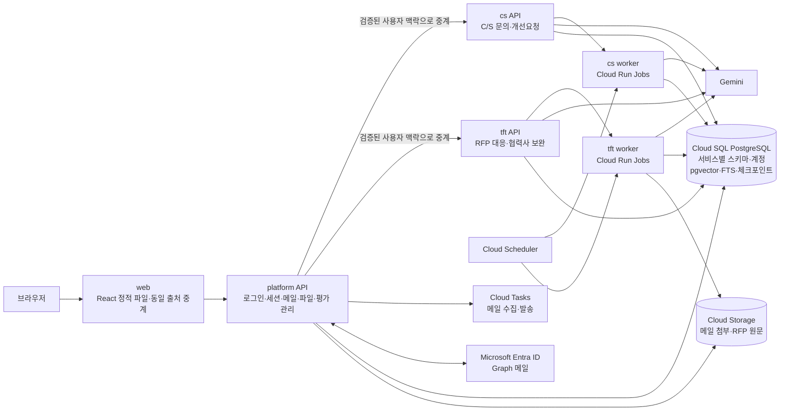

# Team4 업무지원 AI

해외 고객 C/S 문의 대응과 전력 사업 RFP 자사 대응·협력사 보완을 돕는 두 AI Agent 서비스입니다.
LS·성균관대 AI Agent 교육 과정 4조 최종 프로젝트(2026-11-10 발표)입니다.

*Two AI agents for an electrical equipment maker: overseas customer support and RFP response, with people making every final call.*


### 프로젝트 1 · 해외 고객 C/S AI Agent


[▶ 전체 데모 보기 (MP4, 3분 29초, 소리 없음)](docs/assets/readme/p1-demo.mp4)

### 프로젝트 2 · 전력 사업 RFP 대응·협력사 보완 AI Agent


[▶ 전체 데모 보기 (MP4, 2분 45초, 소리 없음)](docs/assets/readme/p2-demo.mp4)

> 화면과 수치는 모두 LS가 교육용으로 제공한 합성 데이터와 시연용 가상 인물·가상 협력사로 만든 것입니다. 실제 LS 제품, 고객, 업체와 관계가 없습니다.

## 무엇을 하나요

### 프로젝트 1: 해외 고객 C/S AI Agent

해외 고객이 메일로 보낸 문의를 C/S 담당자가 접수해서 회신하고, 같은 고장이 반복되면 담당 부서에 개선요청까지 넘기는 흐름을 돕습니다. AI는 읽고 요약하고 초안을 쓰고, 우선순위·담당 부서·응답 기한은 정책 표를 그대로 옮긴 규칙이 계산하며, 고객에게 나가는 회신과 확정은 담당자가 합니다.

- **문의 분류와 받은 정보 확인**: 문의 유형, 긴급 여부(안전·현장 정지 포함), 보조 유형, 고객이 이미 보낸 자료(모델·시리얼·오류 코드·운전 조건 등)를 AI가 읽고, 빠진 자료와 다음 행동(추가 정보 요청·답변·부서 이관)을 제안합니다.
- **규칙으로 계산하는 우선순위·담당 부서·SLA**: AI 분류를 입력으로 결정론적 규칙이 계산합니다. 모델에게 이 값을 묻지 않습니다.
- **설치 장비 확인**: 문의 속 시리얼·모델과 고객 보유 장비를 대조해 후보를 보여 주고 담당자가 확정합니다.
- **근거 검색과 회신 초안·검증**: 제품 문서와 정책 문서에서 근거를 찾아 초안을 쓰고, 문장마다 근거가 있는지와 RMA·방문·보증 같은 확정 약속이 들어갔는지를 다시 검사합니다. 부서 답변이 오면 그 답변을 바탕으로 초안을 새로 씁니다.
- **한국어 번역 보조**: 외국어 원문과 영어 초안을 한국어로 보여 주고, 담당자가 한국어로 고친 내용을 원래 언어 초안에 반영합니다.
- **같은 고장 AI 추천**: 해결 기록을 남길 때 같은 제품의 기존 고장 목록과 해결 기록을 비교해 같은 고장을 추천하고, 애매하면 판단을 보류해 사람에게 넘깁니다.
- **반복 이슈 감지와 개선요청**: 같은 고장이 90일 안에 서로 다른 고객 3곳에서 나오면 개선요청을 만들고, 확인된 사실·불일치·미확인 정보·검토 과제를 나눈 AI 초안을 붙여 부서에 전달합니다. 부서 조치와 후속 확인까지 기록합니다.

<table>
<tr>
<td width="50%"><br><sub>AI 분류·받은 자료 확인·다음 행동 제안</sub></td>
<td width="50%"><br><sub>부서 답변 기반 회신 초안과 한국어 번역</sub></td>
</tr>
<tr>
<td><br><sub>해결 기록에서 같은 고장 AI 추천</sub></td>
<td><br><sub>반복 고장에서 만든 개선요청 AI 초안</sub></td>
</tr>
</table>

### 프로젝트 2: 전력 사업 RFP 대응·협력사 보완 AI Agent

메일로 받은 제안요청서(RFP)를 영업 담당자가 등록하면, 문서를 조항 단위로 나누고 요구를 뽑아 자사 제품 사양과 비교한 뒤, 모자란 부분의 보완 경로를 정리해 검토본 초안까지 만드는 흐름을 돕습니다. 시연은 변전소 규격서 한 건(DOCX)으로 진행합니다.

- **조항 구조와 편집 흔적**: DOCX·PDF를 조·항·표 단위의 조항 트리로 바꾸고, 변경 추적으로 지워진 값도 남깁니다. 문서 속 그림은 OCR로 읽되 검토할 근거로만 씁니다.
- **요구 추출**: 조항에서 설비·속성·요구값·단위·조건을 뽑고, 같은 설비에 걸린 요구를 묶습니다.
- **자사 사양 비교**: 같은 속성·같은 단위·같은 조건끼리만 코드 규칙으로 비교해 근거 확인, 조건부, 사양 차이, 근거 부족 네 가지로 판정합니다. 검색은 후보를 찾는 데만 쓰고 유사도 점수로 충족을 정하지 않습니다.
- **보완 경로와 가상 협력사**: 부족 원인(정격·인증·형식·과업·상업 조건 등)에 따라 다른 자사 제품, 자사 개발(R&D 확인), 외부 제품·과업 위탁·공동 제안, 대체 사양 제안(Deviation) 같은 경로를 먼저 볼 순서대로 보여 줍니다. 협력사 경로에는 가상 협력사 후보를 붙이고, 자사 비교와 같은 규칙으로 등급을 매깁니다. 요구마다 편차로 기재하거나 기술 부서에 충족 근거 확인을 요청하거나 고객 질문을 만들 수 있습니다.
- **사람의 결정 관문**: 요구를 바꾸는 입력(웹 수정, 고객 회신, 기술 부서 회신)은 변경 제안으로 들어오고, 담당자나 사업 책임자가 승인한 것만 반영됩니다. AI가 만든 값은 `ai_draft`로 표시해 사람이 확인한 값과 구분합니다.
- **검토본 초안과 내보내기**: 검토본을 요약서 DOCX와 대응 현황 XLSX(요구별 판정·편차표·질의서·현황표 시트)로 내보냅니다.

<table>
<tr>
<td width="50%"><br><sub>조항별 요구 추출 진행</sub></td>
<td width="50%"><br><sub>자사 사양 비교 판정과 기술 부서 확인 요청</sub></td>
</tr>
<tr>
<td colspan="2"><br><sub>검토본 XLSX(요구별 판정·편차표·질의서·현황표)</sub></td>
</tr>
</table>

## 성능 평가 요약

모든 수치는 LS가 교육용으로 제공한 **합성 데이터**에서 잰 값입니다. 문의 문장이 템플릿에 가까워 실제 문의에서의 성능을 뜻하지 않으며, 각 측정은 한 번 실행한 결과입니다. 계산법과 합격선은 [평가 명세](docs/evaluation.md)에 있습니다.

| 영역 | 지표 | 결과 | 측정 조건 |
| --- | --- | --- | --- |
| C/S 분류 | 문의 유형 macro-F1 | **.967** (575/597 맞음) | 시험 분할 597건. 지시문 조정에 쓰지 않은 분할, 합격선 ≥ .90 |
| C/S 분류 | 안전·현장 정지 긴급 놓침 | **0/26** | 같은 시험 분할, 합격선 0건 |
| C/S 담당 부서 | AI 분류 → 규칙 계산 일치 | **580/597** (97.2%) | 틀린 17건은 모두 AI 분류 오류에서 시작 |
| C/S 근거 검색 | 상위 5개 안 기대 문서(hit@5) | **.985** (588/597) | 정답은 규칙으로 만든 기대 문서(사람 검수 아님) |
| C/S 회신 초안 | 한 번 고쳐 쓴 뒤 최종 검증 통과 | **100/100** | 시험 분할에서 뽑은 100건. 검증은 모델 판정 |
| 같은 고장 판단 | 기존 고장 맞음 / 다른 고장에 잘못 합침 | **AI 81.2% / 2.8%**<br>임베딩 64.7% / 46.1% | 시험 분할 해결 기록 104건(기존 고장 85건). 임베딩은 gemini-embedding-2 최근접 묶음 |
| RFP 요구 추출 | 재현율 / 정밀도 | **71.1% / 56.1%** | 규칙 조정에 쓰지 않은 문서 5건(holdout) |

- 같은 고장 판단에서 임베딩에 "새 고장" 기준값을 검증 분할로 맞춰 주면 잘못 합침은 줄지만, AI 수준(6.5% 이하)에 닿는 기준값에서는 기존 고장 맞음이 85건 중 1건으로 떨어졌습니다.
- RFP 요구 추출은 평가 문서에서 재현율 89.8%까지 나왔지만, 그 문서를 보면서 다듬은 규칙이 섞인 참고값입니다. 독립 성능은 위 holdout 값으로 봅니다.

## 기술 스택

| 구분 | 사용 기술 |
| --- | --- |
| 백엔드 | Python 3.11 이상(실행 이미지 3.12), FastAPI 0.115+, Uvicorn, Pydantic Settings, psycopg 3·psycopg-pool |
| AI | Google Gen AI SDK(Gemini, 운영 기본 `gemini-3.6-flash`), 임베딩 `gemini-embedding-2`, LangGraph 1.x와 PostgreSQL 체크포인트 |
| 검색 | PostgreSQL FTS, pgvector |
| 문서 처리 | DOCX 직접 파싱, pypdf, 그림 OCR(검토용 근거), XLSX·DOCX 내보내기(표준 라이브러리 zip) |
| 인증·메일 | Microsoft Entra ID(MSAL, PKCE), 서버 세션 쿠키, Microsoft Graph 메일 읽기·발송, Web Push 알림 |
| 프론트 | React 19, TypeScript 5, Vite 7, TanStack Query 5, React Router 7, openapi-typescript로 API 타입 생성 |
| 데이터 | Cloud SQL PostgreSQL(로컬은 PostgreSQL 17 + pgvector 0.8.7), Cloud Storage |
| 인프라 | Cloud Run(서울 리전) 서비스 4개와 Cloud Run Jobs worker, Cloud Scheduler, Cloud Tasks, Secret Manager, Cloud Build |
| 개발 도구 | uv, Ruff, mypy, pytest, Vitest, Playwright, GitHub Actions |

## 아키텍처



- web, platform, cs, tft는 각각 따로 빌드하고 Cloud Run에 배포합니다. 브라우저는 web과 platform만 보며, cs·tft 요청은 platform이 세션을 확인한 뒤 내부 호출로 넘깁니다.
- 세 백엔드는 PostgreSQL DB 하나를 쓰되 스키마와 접속 계정을 나눠 자기 데이터만 수정합니다.
- 오래 걸리는 C/S 분석과 RFP 문서 처리는 worker가 맡고, 작업 상태는 PostgreSQL에 둡니다.

자세한 경계와 선택 이유는 [아키텍처](docs/architecture.md)와 [의사결정](docs/decisions.md)에 있습니다.

## 저장소 구조

```text
backend/
  api/        cs · tft · platform FastAPI 앱과 공통 앱 설정
  engine/     규칙, 문서 파싱, 검색, C/S·RFP 단계별 로직
  agent/      worker 실행, LangGraph 실행기, 처리 등록
  shared/     설정, DB, 인증 검사, AI 제공자, 로그 등 공통 코드
frontend/     통합 웹(React)과 정적 서버·중계(server.mjs)
contracts/    서비스별 API·데이터 계약 문서
docs/         아키텍처, 온보딩, 배포·운영, 평가 명세, OpenAPI
eval/         평가 실행기와 지표, 정책 표
infra/        마이그레이션, Cloud Build, 배포·설정 스크립트
scripts/      로컬 실행(workspace.py), 검사, 측정 실행 도구
tests/        서비스별·공통 테스트
```

## 빠른 시작

로컬 실행에는 GCP 권한, Gemini 키, Microsoft 시크릿이 필요하지 않습니다. Docker, Python 3.11 이상, uv, Node.js 22.12 이상을 준비한 뒤 [팀원 개발 시작 안내](docs/team-start.md)의 1~5단계를 따르면 로컬 DB, API 3개, 프론트가 뜨고 합성 시연 계정으로 화면을 볼 수 있습니다. 기본 모드는 모의 응답이며, 실제 모델 호출은 같은 문서의 "실제 모델 호출" 절을 참고하세요.

## 개발 문서

| 확인할 내용 | 위치 |
| --- | --- |
| 처음 설치, 로컬 DB와 계정 선택, 프론트 실행, 문제 해결 | [팀원 개발 시작 안내](docs/team-start.md) |
| 이름별 첫 작업, WBS 개발 순서와 협업 경계 | [노션 개발 온보딩](https://www.notion.so/401910042c3781ed9768f13ef422a4f8) |
| 서비스 구조와 선택 근거 | [아키텍처](docs/architecture.md), [의사결정](docs/decisions.md) |
| 서비스별 API 원본과 생성 명령, 충돌 방지 규칙 | [계약 수정 안내](contracts/README.md) |
| 기획서의 출력·출처 정의와 평가 계산법 | [C/S 계약](contracts/cs/tickets.md), [데이터 계약](docs/data-contract.md), [평가 명세](docs/evaluation.md) |
| 서비스별 CI, 이미지와 CD 및 공용 웹 준비 | [서비스별 배포 안내](docs/service-delivery.md) |
| 로그와 실제 백업 확인 | [기본 운영 확인](docs/operations-basics.md) |
| 배포 뒤 확인, 이전 리비전 되돌리기, 백업 복구 훈련 | [배포 확인 런북](docs/release-runbook.md) |
| 배포 순서와 승인 판정 | [배포 승인 점검표](docs/release-approval.md) |
| API 로컬 실행, 테스트, OpenAPI와 Docker 빌드 | [백엔드 실행 안내](backend/README.md) |
| GCP DB, Secret 및 연결 검증 | [인프라 안내](infra/README.md) |
| 프로젝트 목표, 현재 단계, 주요 링크 | [프로젝트 시작 안내](https://docs.google.com/document/d/1CI2gyXEogmcSIeAKceK9xsurv_ls8lJ3uOac45k6jqk/edit) |
| 담당 업무, 진행 상태, 완료 결과 | [Jira KAN 보드](https://lsteam4.atlassian.net/jira/software/projects/KAN/boards/1) |
| 문서·회의·검토·인수인계 운영 | [협업 운영 기준](https://docs.google.com/document/d/10xunkXSy_73YSvlRKBRzNNeRAIk23FMc4XmpT6ywv2Q/edit) |
| 기획서와 WBS 원본 | [Google Drive docs 폴더](https://drive.google.com/drive/folders/1qGourXRhyvCMKRd6wZtOylAx4iuQKSeS) |
| 작업 브랜치와 PR 작성 방법 | [기여 안내](CONTRIBUTING.md) |

작업은 Jira에서 시작하고 KAN 번호를 브랜치·커밋·PR에 넣습니다. 기획·조사 문서의 원본은 Google Docs·Drive에 두고 이 저장소에는 링크만 둡니다. 팀 소통은 Discord **오샤오치**, GitHub 알림은 **#github-log** 채널을 씁니다.

## 팀과 역할

| 담당 | 맡은 범위 |
| --- | --- |
| 김나영 | 메일, 사용자 등록·업무 권한, C/S API와 결정론적 규칙, 통합 회귀, RFP 데이터 구조·조항 추출·자사 비교·판정 |
| 오새결 | Microsoft 인증·서버 세션, 인프라와 배포, 입력 어댑터·검색, C/S·RFP의 AI 단계, 가상 협력사 후보·등급 규칙, RFP 대응표·초안·변경 제안, 평가 관리 API·화면·지표 |
| 김종하 | 프론트(평가·RFP 대응표 제외), RFP 조항 정리와 통합 시험 |

최신 배정과 수정 경계는 [AGENTS.md](AGENTS.md#현재-담당과-수정-경계)와 Jira를 따릅니다.

## 데이터와 라이선스 고지

- 문의, 해결 기록, 제품 사양, RFP 문서, 협력사 프로필은 LS가 교육 과정용으로 제공한 합성 데이터이거나 팀이 시연용으로 만든 가정 자료입니다. 실제 LS 제품·고객·거래와 무관하며, 협력사는 가상 프로필(`profile_source=synthetic`)입니다.
- 화면에 나오는 사람 이름은 시연용 계정이고, 고객 메일 주소는 예시 도메인입니다.
- 가격과 납기에는 적용 정책·가정·미확정 조건을 함께 표시하며, 개발·회귀용 사례와 최종 평가 자료를 나눠 씁니다.
- 원천 데이터(`data/`)는 저장소에 포함하지 않습니다.
- 이 저장소에는 별도 라이선스 파일이 없습니다. 코드나 자료를 다시 쓰려면 팀에 먼저 문의해 주세요.
