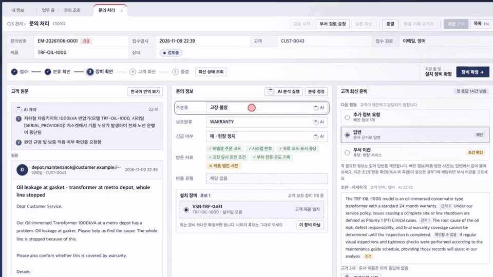
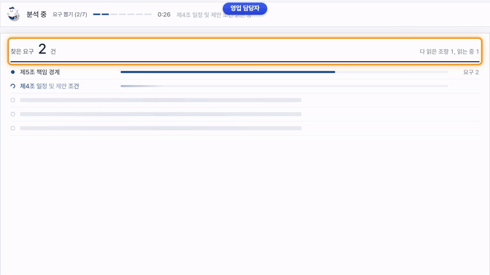
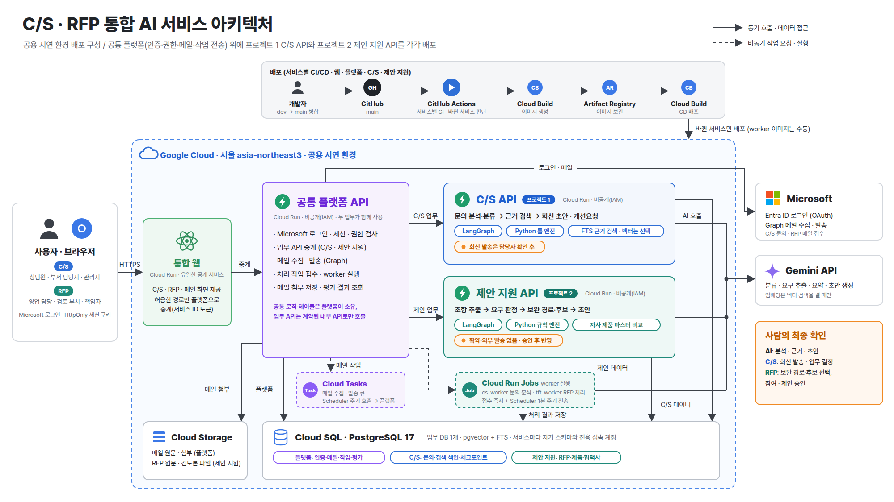

# Team4 업무지원 AI

해외 고객 C/S 문의 대응과 전력 사업 RFP 대응을 돕는 두 AI Agent 서비스입니다. LS·성균관대 AI Agent 교육 과정 4조 최종 프로젝트(2026-11-10 발표)입니다.

## 프로젝트 1 · 해외 고객 C/S AI Agent

메일로 들어온 해외 고객 문의를 분류하고 근거를 찾아 회신 초안을 쓰며, 반복되는 고장은 담당 부서 개선요청으로 넘깁니다.

- 문의 유형과 긴급 여부는 AI가 읽고, 우선순위·담당 부서·응답 기한은 정책 표를 옮긴 규칙이 계산합니다.
- 제품·정책 문서에서 근거를 찾아 회신 초안을 쓰고, 문장마다 근거가 있는지와 확정 약속이 섞였는지 다시 검사합니다.
- 해결 기록을 남길 때 같은 고장을 추천하고, 90일 안에 고객 세 곳에서 반복되면 개선요청 초안을 붙여 부서에 넘깁니다.
- 고객에게 나가는 회신은 담당자가 확인한 뒤에만 발송됩니다.

[▶ 전체 데모 (MP4, 3분 29초)](docs/assets/readme/p1-demo.mp4)

## 프로젝트 2 · 전력 사업 RFP 대응·협력사 보완 AI Agent

메일로 받은 제안요청서(RFP)에서 요구를 뽑아 자사 사양과 비교하고, 모자란 부분의 보완 경로와 검토본 초안을 만듭니다.

- DOCX·PDF를 조항 단위로 나누고, 변경 추적으로 지워진 값까지 남깁니다.
- 요구값과 자사 사양을 같은 속성·단위·조건끼리만 규칙으로 비교해 네 가지로 판정합니다.
- 부족한 요구에는 다른 자사 제품, 자사 개발, 가상 협력사, 대체 사양 같은 보완 경로를 순서대로 보여 줍니다.
- 사람이 승인한 변경만 반영하고, 검토본을 DOCX 요약서와 XLSX 대응 현황으로 내보냅니다.

[▶ 전체 데모 (MP4, 2분 45초)](docs/assets/readme/p2-demo.mp4)

## 아키텍처

브라우저는 공개 웹 하나만 거칩니다. 로그인·메일·작업 전송은 공통 플랫폼이 맡고, 시간이 걸리는 C/S 분석과 RFP 문서 처리는 Cloud Run Jobs worker가 처리합니다. 그림 원본은 [architecture.html](docs/assets/readme/architecture.html)입니다.

| 구분 | 기술 |
| --- | --- |
| 백엔드·AI | Python, FastAPI, LangGraph, Gemini(`gemini-3.6-flash`) |
| 프론트 | React 19, TypeScript, Vite, TanStack Query |
| 데이터·인프라 | Cloud SQL PostgreSQL 17(FTS·pgvector), Cloud Storage, Cloud Run, Cloud Build, GitHub Actions |
| 연동 | Microsoft Entra ID 로그인, Microsoft Graph 메일 |

## 성능

합성 교육 데이터 기준이며, 지시문이나 규칙 조정에 쓰지 않은 시험 자료에서 잰 값입니다.

- **C/S**: 시험 597건에서 문의 유형 macro-F1 .967, 안전·현장 정지 긴급 놓침 0/26, 근거 문서 hit@5 .985
- **같은 고장 판단**: 해결 기록 104건에서 AI가 기존 고장을 81% 맞히고 다른 고장에 잘못 합친 비율은 2.8%(임베딩 최근접은 65%, 46%)
- **RFP 요구 추출**: 조정에 쓰지 않은 문서 5건에서 재현율 71.1%

측정 조건과 전체 표는 [프로젝트 상세](docs/PROJECT_OVERVIEW.md#성능-평가)에 있습니다.

## 문서

- [프로젝트 상세](docs/PROJECT_OVERVIEW.md): 기능별 설명과 화면, 성능 표, 데이터 고지
- [개발 안내](docs/DEVELOPMENT.md): 로컬 실행, 저장소 구조, 개발 문서 목록, 협업 방식
- [아키텍처](docs/architecture.md) · [의사결정](docs/decisions.md) · [평가 명세](docs/evaluation.md) · [배포 안내](docs/service-delivery.md)

화면과 수치는 LS가 교육용으로 제공한 합성 데이터와 시연용 가상 인물·가상 협력사로 만들었으며, 실제 LS 제품·고객·업체와 관계가 없습니다.
