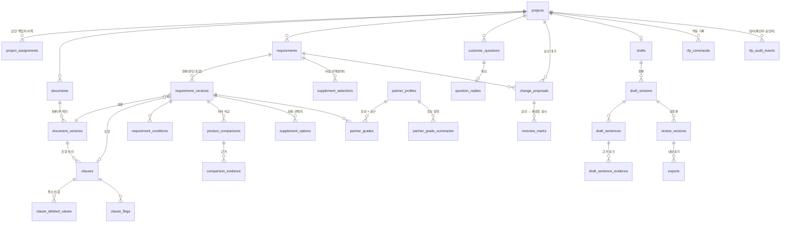

# RFP 자사 대응 데이터 구조와 API 골격 (KAN-182, A01)

원본 합의: [RFP 자사 대응·협력사 보완 API 명세 v1.1](https://docs.google.com/document/d/1lh6blP9IqACKvr3nyPp7NuU07jOmliIvIH_h87HDu9g)(2026-10-28, 기획서 최종본 수정본 4·6장). 이 문서는 그 명세의 §2.1 상태 값, §4.1 프로젝트 확장, §6 저장 구조를 코드로 옮긴 결과와 설계 이유다.

| 원본 | 파일 |
| --- | --- |
| 상태 값·HTTP 모델(OpenAPI 초안의 원본) | `backend/api/tft/rfp/schemas.py` |
| 경로 골격 21개(구현 전 501 `TFT_NOT_IMPLEMENTED`, OpenAPI `x-implementation-status: planned`). 15·16·18·19·20은 구현(KAN-189), 11·30 접수는 [작업 계약](rfp-jobs.md#tft-접수-경로-1130-kan-199kan-188) | `backend/api/tft/rfp/routes.py`, `routes_supplement.py`, `routes_questions.py`, `jobs.py` |
| 저장 구조 | `infra/migrations/tft/20261029_KAN-182_rfp_response.sql` |
| 생성 OpenAPI | `docs/openapi/tft.json` |

**구현 범위 구분**: 이 PR은 데이터 구조·상태 값·경로 선언까지다. 경로 동작은 KAN-188(A07: 1~19·25·28·29)·KAN-189(A08: 20~24·26·27)·KAN-192(A12: 30)가 구현한다. 1·3번(목록·상세)은 기존 `projects/routes.py`에 있고 응답 확장(`RfpProjectSummary`·`RfpProjectDetail`)은 A07이 바꾼다.

## 왜 점수 하나 대신 네 가지 상태인가

요구 하나의 판단을 0~100 같은 적합도 점수 하나로 두지 않고 네 가지 상태로 둔다.

| 상태 | 뜻 | 다음 행동 |
| --- | --- | --- |
| `EVIDENCE_FOUND` 자사 대응 근거 있음 | 같은 속성·단위·조건으로 비교한 자사 근거가 있음 | 초안에 근거와 함께 쓴다 |
| `CONDITIONAL` 조건부 대응 검토 | 조건(온도 상승, 2차 전압 등)이 맞을 때만 대응 | 조건을 확인하거나 질문한다 |
| `SPEC_GAP` 사양 차이 확인 | 자사 근거가 요구와 다름(예: 15kV 요구에 12kV) | 보완 경로를 고른다 |
| `INSUFFICIENT_EVIDENCE` 판단 근거 부족 | 자료가 없거나 비교할 수 없음 | 자료를 요청하거나 질문한다 |

1. **평균이 필수 미충족을 숨긴다.** 필수 요구 하나가 사양 차이인데 나머지가 다 맞으면 점수는 높게 나온다. 그 하나가 입찰 탈락 사유다. 상태로 두면 미해결 필수 요구 수(`unresolved_mandatory_count`)가 따로 보인다.
2. **상태마다 다음 행동이 다르다.** 근거 부족이면 자료 요청, 조건부면 조건 확인·질문, 사양 차이면 보완 경로다. 점수 72와 68은 무엇을 해야 하는지 알려 주지 않는다.
3. **"자료 없음"과 "안 맞음"을 섞지 않는다.** 자료가 없는 것은 판단 근거 부족이지 미충족이 아니다. 점수로는 0점(근거 없음)과 0점(불충족)이 같아진다.
4. **사람이 확인·뒤집을 수 있다.** 상태와 사유(`reason`)·미확인 사항(`unresolved`)은 담당자가 읽고 변경 제안으로 바꿀 수 있다. 점수는 근거를 거슬러 설명하기 어렵다.

협력사 후보도 같은 원칙이다. 후보 × 요구마다 등급(`MANDATORY_CONFIRMED`·`REVIEW`·`REFERENCE_ONLY`·`EXCLUDED`)을 계산하고, 필수 제약을 어긴 후보는 점수와 무관하게 `EXCLUDED`다. 유사도 점수는 응답에 내지 않는다.

## 상태 값 (명세 §2.1)

| 구분 | 값 |
| --- | --- |
| 산출물 상태 `output_status` | `INTAKE`·`ANALYZING`·`REVIEW_DRAFT` (입찰 통과·수주와 별개) |
| 판단 상태 `judgement_status` | `NEEDS_REVIEW`·`CONDITION_CHECK`·`OWNER_CONFIRMED` (산출물 상태와 서로 대체하지 않음) |
| 요구 상태 `status` | `EVIDENCE_FOUND`·`CONDITIONAL`·`SPEC_GAP`·`INSUFFICIENT_EVIDENCE` |
| 요구 성격 `necessity` | `MANDATORY`·`PREFERRED`·`CONDITION_BOUND`·`UNDETERMINED` (요구 상태 `CONDITIONAL`과 다른 단어) |
| 보완 경로 `path` | `OTHER_OWN_PRODUCT`·`OWN_DEVELOPMENT`(자사 개발·수행 확인, R&D)·`OWN_TERMS_REVIEW`(자사 조건 변경 검토, 명세 추가 요청 중)·`ALTERNATIVE_SPEC`·`EXTERNAL_PRODUCT`·`TASK_SUBCONTRACT`·`JOINT_PROPOSAL`·`CUSTOMER_SPECIFIED_PROCUREMENT`(고객 지정품 조달)·`NONE` (명세 v1.3, 마이그레이션 T9) |
| 다음 담당 `next_owner_field` | `SALES`·`TECH`·`PURCHASE`·`CUSTOMER`·`RND`(R&D 자문 질문이 열린 요구, 명세 v1.3) |
| R&D 확인 `rnd_check`(요구 판본) | `NOT_REQUIRED`(기본)·`PENDING`·`CONFIRMED_FEASIBLE`·`CONFIRMED_NOT_FEASIBLE`·`CONFIRMED_SCHEDULE_MISMATCH`·`WAIVED` (마이그레이션 T10) |
| 질문 대상 `target` / `target_dept` | `CUSTOMER`(기본, v1.2 동작)·`INTERNAL`(부서 필수). 내부 자문 유형 `RND_FEASIBILITY`·`TECH_ADVICE`·`PURCHASE_TERMS`는 `INTERNAL`에만 |
| R&D 답변 | `rnd_feasibility` `FEASIBLE`·`FEASIBLE_WITH_SCHEDULE`·`NOT_FEASIBLE`·`UNDETERMINED`, `earliest_available_on`, `schedule_fits`(개발 가능성 없이 일정 칸만은 저장하지 않음) |
| 면제 사유 `rnd_check_waiver_reason`(보완 선택) | 20~1000자. 열린 R&D 질문이 있는 협력사 경로 선택에만 |
| 부서 분류 `tft.department_kinds` | `SALES`·`RND`·`TECH`·`PURCHASE`·`OTHER`. tft_app은 읽기만 |
| 전략 고객 `projects.strategic_customer`(+`_note`·`_set_by`·`_set_at`) | true·false·null(미입력). 영업 입력 표시값(가설)이고 상태·등급·경로 순위·검토본 조건·평가 입력에 쓰지 않는다. 값을 넣으면 넣은 사람·시각이 함께 있다(T11) |
| 통합 책임 `projects.integration_holder`(+`_candidates`·`_note`·`_set_by`·`_set_at`) | `OWN`·`SINGLE_PARTNER`·`JOINT`·`UNRESOLVED`(기본). 미확보가 아니면 정한 사람·시각이 있다. 필요 여부·근거 조항은 서버 계산([통합 책임](rfp-integration.md)) |
| 지정품 `requirement_versions.designated_manufacturer`·`designated_procurement`·`designated_clause_id` | 처리 방식 `SPECIFIED_PROCUREMENT`·`ALTERNATIVE_PROPOSAL`·`UNDECIDED`. `designated_model`(T7)이 있을 때만 값이 있다 |
| 선택의 R&D 확인 `supplement_selections.rnd_check` | 6값. 면제 사유는 `WAIVED`일 때만 |
| 감사 기록(앱 규칙, A07·A08) | 전략 고객·통합 책임 변경, INTERNAL 질문 생성·답변을 `audit_events`에 from/to로 남긴다 |
| 부족 원인·고객 허용 | `RATING`·`CERTIFICATION`·`FORM`·`TASK`·`DESIGNATED_MODEL`(타사 지정 모델)·`COMMERCIAL`(상업 조건)·`CORE_EQUIPMENT_MISSING`(핵심 기기 부재) / `ALLOWED`·`FORBIDDEN`·`UNSTATED` |
| 후보 등급 `grade` | `MANDATORY_CONFIRMED`·`REVIEW`·`REFERENCE_ONLY`·`EXCLUDED` (KAN-187 `grading.Grade` 재사용) |
| 고객 질문 `status` | `OPEN`·`REPLIED` |
| 변경 제안 `origin`/`status` | `web`·`customer_reply`·`pdf_annot` / `PENDING`·`APPROVED`·`REJECTED` |
| 작업 `kind`/`step` | `rfp.process`·`rfp.export`·`rfp.annotate` / `parse`…`annotate` (플랫폼 `runtime.jobs`, owner=`tft`) |
| 출처 | `data_origin`(`synthetic`·`demo`·`real`, 기본값 없이 필수), `derivation_kind`(`PROVIDED`·`DERIVED`·`SYSTEM`·`ASSUMED`), `provenance_kind`(`ai_draft`·`human_input`·`system_record`) |

## ERD

## 저장 구조 (명세 §6)

| 묶음 | 표(`tft` 스키마) | 판본 | `tft_app`이 바꿀 수 있는 열 |
| --- | --- | --- | --- |
| 프로젝트 | `projects`(열 추가: `output_status`·`judgement_status`·`purpose`·`customer_goal`·`review_departments`·`review_version`), `project_assignments` | 프로젝트 `version` | 기존 KAN-119 권한 그대로(표 전체 UPDATE). 상태 두 개는 서버 규칙으로만 바꾼다(앱이 지킴, 권한 축소는 Z 단계) |
| 문서 | `documents`, `document_versions`, `clauses`, `clause_deleted_values`, `clause_flags` | 문서 판본 | `documents.latest_version` |
| 요구 | `requirements`, `requirement_versions`(원문 위치·내용·판단), `requirement_conditions` | 요구 판본 | `requirements.latest_version` |
| 자사 비교 | `product_comparisons`, `comparison_evidence` | 요구 판본에 종속 | 없음 |
| 보완 경로 | `supplement_options`(계산), `supplement_selections`(사람 선택) | 선택 판본 | 없음 |
| 협력사 | `partner_profiles`(KAN-184 `profiles.json` 키, `synthetic`·`PROVIDED` 고정), `partner_grades`, `partner_grade_summaries`(KAN-187 출력, `DERIVED`) | 프로필 판본 | 없음 |
| 고객 질문 | `customer_questions`, `question_replies` | 질문 판본 | `status`·`version`·`updated_at` |
| 변경 제안 | `change_proposals` | 제안 판본 | `status`·`decided_by`·`decided_at`·`decision_note`·`version` |
| 초안·검토본 | `drafts`, `draft_versions`, `draft_sentences`, `draft_sentence_evidence`, `review_versions`, `exports` | 초안 판본 | `drafts.latest_version`, `exports`의 `job_id`(접수 뒤)·파일 열(완료 기록) |
| 재검토 표시 | `rereview_marks`(제안 승인 때 연결 요구·비교·보완·초안 문장마다 한 행) | — | `cleared_by`·`cleared_at`(사람이 다시 확인) |
| 멱등 기록 | `rfp_commands`(사용자·동작·`Idempotency-Key`마다 첫 결과) | — | 없음 |
| 감사 | `rfp_audit_events`(모든 쓰기, 승인은 제안자·승인자 함께) | — | 없음 |

- **모든 업무 행**에 `version`·`data_origin`·`derivation_kind`·`known_at`을 둔다. 예외는 업무 판단이 아니라 사람 행동·시스템 기록이거나 부모 판본에 딸린 행이며, 출처는 부모 또는 행위자·시각 열로 대신한다.
  - 부모를 따르는 세부 행: `clause_deleted_values`·`clause_flags`(조항), `comparison_evidence`(비교), `draft_sentences`·`draft_sentence_evidence`(초안 판본), `requirement_conditions`(요구 판본)
  - 사람 행동 기록(행위자·시각 열): `project_assignments`, `review_versions`, `exports`, `rereview_marks`
  - 시스템 기록: `rfp_commands`(멱등), `rfp_audit_events`(감사)
- **추가만**: 위 표에 `tft_app`은 SELECT·INSERT만 가지고 UPDATE·DELETE·TRUNCATE는 없다. 최신 판본 포인터와 상태 열만 열 단위 UPDATE를 연다. 판본을 고치지 않고 새 판본을 쓴다(명세 §2.3).
- **재검토 표시는 판본과 따로 둔다.** 판본 행은 고치지 않으므로 `needs_rereview` 열을 판본 표에 두지 않는다. 응답의 `needs_rereview`는 대상에 해소 안 된 `rereview_marks` 행이 있는지로 계산한다.
  - 요구의 `needs_rereview`는 위 조건에 하나를 OR로 더한다(KAN-189): 그 요구의 INTERNAL R&D 자문 답변(`issue_type=RND_FEASIBILITY`) 기록 시각이 최신 보완 선택(`supplement_selections.decided_at`)보다 뒤면 참이다. 보완 선택이 없으면 이 조건은 보지 않고, 새 선택이 생기면 꺼진다. R&D 답변은 변경 제안을 만들지 않으므로(명세 v1.3 §5.3) 제안에 묶인 `rereview_marks` 행을 남길 수 없어 계산으로 둔다. 구현은 `backend/api/tft/rfp/repository.py`의 `needs_rereview`다.
  - 후속 제안(KAN-182): 답변을 표시 원인으로 저장하려면 `rereview_marks`에 `cause_question_id`(질문 FK, `cause_proposal_id`와 둘 중 하나)를 허용하는 확장이 필요하다. 그때까지는 위 계산이 원천이다.
- **R&D 확인 `rnd_check`는 읽을 때 계산한다(KAN-189).** 원천은 `rnd.rnd_check_of(그 요구의 R&D 자문 질문·답변, WAIVED로 저장된 최신 보완 선택의 결정 시각)`이다(`repository.rnd_check`). 이 값을 바꾸려고 요구 판본을 새로 쓰거나 제자리 갱신하지 않는다. 비교·보완 선택지가 요구 판본에 묶여 있어 판본만 올리면 최신 판본의 비교가 비기 때문이다. `requirement_versions.rnd_check`(T10)는 다른 흐름이 판본을 새로 만들 때만 그 시점 값으로 채운다. 보완 선택 판본의 `rnd_check`는 선택 시점의 값(면제면 `WAIVED`)을 남긴다.
- **DB가 지키는 규칙**: 질문·제안·후보 등급의 요구는 같은 프로젝트 요구만 가리킨다((project_id, requirement_id) 복합 참조), 사람 판단 판본은 판단자·시각 필수, 비교 불가면 결과가 `NOT_COMPARABLE`/`NO_DATA`, 고객이 금지한 보완 경로는 `allowed=false`·사유 필수, 제외 사유가 있으면 등급 `EXCLUDED`, 조항에 못 맞춘 제안은 요구 없이 `clause_unresolved=true`, 사용자 제안은 제안자 필수, 기각은 사유 필수.
- **판본 유일 키**(`20261030_KAN-182_rfp_keys.sql`): 비교·보완 선택지·후보 등급·후보 요약은 같은 대상의 같은 `version`을 한 번만 저장한다. 다시 계산할 때는 version을 늘린다. 재검토 표시의 원인 제안은 같은 프로젝트 제안만 가리킨다.
- **앱이 검사하는 프로젝트 소속**: 아래 참조는 DB가 프로젝트 일치를 보증하지 않는다. 경로 구현(KAN-188·189)이 쓰기 전에 같은 프로젝트인지 확인하고, 다르면 404로 처리한다.
  - `requirement_versions.document_version_id`·`clause_id`
  - `customer_questions.clause_id`
  - `supplement_options.permission_clause_id`
  - `rereview_marks.target_id`
  - 근거 링크(`comparison_evidence`·`draft_sentence_evidence`)
  - 복합 참조로 바꾸려면 `document_versions`·`clauses`에 `project_id`를 복제해야 해서 두지 않았다.
- **손대지 않은 것**: 기존 `projects.status`(옛 TFT 단계)와 CHECK, KAN-119의 인력 구성 표. 기존 `rfp_requirements`는 현재 상세 응답이 읽으므로 그대로 두고, 새 요구 표로 옮기는 일은 경로 구현(A07) 때 읽기 전환과 함께 한다.
- 작업 저장은 플랫폼 `runtime.jobs`를 owner=`tft`로 쓴다(명세 결정 4). 작업 종류 등록 마이그레이션과 내부 접수 엔드포인트는 플랫폼 쪽 후속 PR이다.

## 인증

모든 RFP 경로는 라우터 단위 의존성(`rfp_principal`)으로 사용자 맥락(없으면 401)과 TFT 역할(cs_agent는 403)을 먼저 검사한다. 구현 전 501보다 앞선다. 프로젝트 범위(404)는 경로마다 구현 티켓이 검사한다.

## 판본·동시 수정

문서의 새 판본은 업로드 입력 `supersedes_document_id`로 기존 문서를 지정해 올린다. 별도 대체 관계 열을 두지 않고 같은 `document_id` 아래 `document_versions.version`이 하나 늘어난 행으로 저장한다(다른 프로젝트 문서는 404). 원문 판본이 바뀐 요구는 새 문서 판본을 가리키는 새 요구 판본으로 쌓인다.

쓰기 요청은 읽은 `version`을 본문에 보내고, 최신과 다르면 409 `TFT_VERSION_CONFLICT`다([API 계약](../../docs/api-contract.md#오류와-동시-수정)). 상태를 만드는 POST 12개는 `Idempotency-Key`(8~128자)가 필수이고 OpenAPI에 헤더로 선언돼 있다. 같은 사용자·동작·키의 재전송은 `rfp_commands`에 저장한 첫 결과를 돌려주고, 본문 hash가 다르면 409 `IDEMPOTENCY_CONFLICT`다. 요구의 상태·성격·조건·사유는 변경 제안 승인으로만 새 판본이 된다(승인 전 반영 금지). 예외는 사람의 결정 자체인 보완 선택과 초안 문장 수정이다.

## 경로 15·16·18·19·20 동작 (KAN-189)

- **범위**: 프로젝트를 볼 수 없으면(`can_view_rfp`: 담당·관리 범위 또는 검토 부서 `dept_staff`) 없는 것과 같은 404(`TFT_PROJECT_NOT_FOUND`·`TFT_REQUIREMENT_NOT_FOUND`·`TFT_QUESTION_NOT_FOUND`)다. 볼 수는 있지만 쓸 수 없으면 403이다. 질문 작성은 담당 sales·책임자·검토 부서 `dept_staff`, 보완 선택은 담당 sales·책임자, 회신은 CUSTOMER면 담당 sales이고 INTERNAL이면 `target_dept` `dept_staff`·담당 sales·책임자다(`projects/access.py`).
- **멱등**: 쓰기 셋(`question.create`·`question.reply`·`supplement.select`)은 `commands.run_command`가 한 트랜잭션에서 기록 재생 → 처리 → 결과 기록을 한다. 판본 409 같은 상태 검사는 처리 안쪽에 있어 재전송은 상태가 바뀐 뒤에도 첫 결과를 받는다. 같은 키가 동시에 처리돼 결과 기록이 기본 키에 걸리면 409 `IDEMPOTENCY_CONFLICT`다(트랜잭션이 중단돼 다시 읽을 수 없다. 다시 보내면 먼저 끝난 결과를 재생한다). 늦은 쪽이 기록 전에 같은 질문 행 잠금을 기다렸다면(20 회신) 먼저 끝난 쪽이 바꾼 판본을 보고 409 `TFT_VERSION_CONFLICT`가 날 수 있다. 어느 409든 데이터는 롤백되고, 같은 키로 다시 보내면 첫 결과를 재생한다.
- **15 선택지**: 최신 요구 판본의 `supplement_options` 행에서 부족 원인·고객 허용·허용 조항·경로별 후보만 읽는다. 순위·게이트·차단은 저장된 `allowed`·순위를 쓰지 않고 `supplement.options_for`(판단 상태·원인, 허용, `designated_model` 유무, 지금의 `rnd_check`, 그 요구의 고객 질문 유무)로 다시 계산한다. 그래서 R&D 답이 오면 협력사 경로 차단이 바로 보인다. 저장 행이 없으면 원인 없음·허용 `UNSTATED`로 계산한다(지정품만 경로가 나온다).
- **16 선택**: 읽은 요구 판본이 최신과 다르면 409 `TFT_VERSION_CONFLICT`다. 그 뒤 15와 같은 계산의 선택지로 `rnd.check_selection`을 한다. 면제로 넘긴 선택에만 사유를 남긴다. `OWN_DEVELOPMENT`를 고르면 열린 R&D 질문이 없을 때 `rnd.rnd_question_for`의 내부 질문을 같은 트랜잭션에서 만들고 선택 판본의 `rnd_check`는 `PENDING`이다.
- **19 질문**: INTERNAL의 `target_dept`가 프로젝트 검토 부서 밖이거나 원문 조항이 프로젝트 문서의 조항이 아니면 422 `VALIDATION_ERROR`다.
- **20 회신**: 응답은 회신된 질문(`QuestionReplyResult`)이고, 제안을 만들었을 때만 `created_proposal`이 있다. INTERNAL 회신은 제안을 만들지 않는다. CUSTOMER 회신은 요구가 있는 질문이면 판단 필드(`status`·`necessity`·`reason`·`conditions`·`unresolved`)를 `current`로 하고 `unresolved`에서 질문 본문에 그대로 들어 있는 항목만 뺀 값을 `proposed`로 한다(명세 v1.2 §4.7·§4.8). 빠지는 항목이 없거나 질문에 요구가 없으면 제안을 만들지 않는다. 제안은 `origin=customer_reply`, `proposer_kind=system`(`proposer_user_id` 없음), `source_ref={question_id, reply_id}`, 근거 문장 "회신 내용 미검증(담당자 확인 필요). 고객 회신: " + 회신 앞 200자(짝짓기가 회신 내용을 보지 않으므로 승인자가 확인한다), `PENDING`이다. `internal_assumption`은 가정(ASSUMED)이라 제안에 쓰지 않는다.
  - 후속 제안(KAN-188/182): 질문과 미해결 항목을 잇는 열이 없어 본문 포함으로 짝짓는다. 질문을 만들 때 대상 `unresolved` 항목을 지정하게 하면 이 추정이 필요 없다.
- **`next_owner_field=RND`**: 판본 열이라 쓰려면 판본을 올려야 하므로 `rnd_check`와 같이 저장하지 않는다. 요구의 `rnd_check`가 `PENDING`이면 읽을 때 `RND`로 계산한다(요구 상세 응답을 구현하는 쪽, KAN-188).

## 미해결 필수 요구 집계 (KAN-196, 2026-10-29)

사용자 결정: `CONDITION_BOUND`도 `MANDATORY`와 함께 집계 대상에 포함한다.
최신 요구 판본의 성격이 이 두 값 중 하나이고 아래 조건 중 하나라도 참이면
`unresolved_mandatory_count`에 요구당 1을 더한다.

- `judgement.status != EVIDENCE_FOUND`
- `judgement.unresolved`가 빈 목록이 아님
- 요구의 `needs_rereview == true`

`PREFERRED`·`UNDETERMINED`는 제외하되 `by_necessity`에서 별도로 표시한다.
보완 경로·후보 선택 자체는 해결이 아니다. 조건부 필수의 적용 여부를 자동 추정해
제외하지 않는다. 사람이 요구 성격을 바꿀 때는 기존 변경 제안·승인 절차를 따른다.
조건부 요구라도 근거 있음·미확인 사항 없음·재검토 없음이면 미해결 건수는 0이다.

공용 함수: `backend.api.tft.rfp.counts.count_unresolved_mandatory(requirements)`.
입력은 같은 프로젝트의 **최신 요구 판본 전체**이며 화면의 페이지 결과를 세지 않는다.
중복 requirement_id는 오류로 거부한다. 최신 판본 선택·프로젝트 접근 검사는 호출자가
수행한다. KAN-188 목록·상세와 KAN-189 검토본 저장은 이 함수를 재사용한다.
현재 해당 경로는 골격이므로 이 함수가 HTTP 응답에 연결됐다는 뜻은 아니다.

예: MANDATORY SPEC_GAP 1건 + CONDITION_BOUND INSUFFICIENT_EVIDENCE 1건 +
PREFERRED SPEC_GAP 1건이면 미해결 필수는 2건이다. EVIDENCE_FOUND라도 unresolved와
재검토가 모두 남은 요구는 1건만 센다.

건수 0만으로 `OWNER_CONFIRMED`로 자동 변경하지 않는다. §4.9의 검토본 저장 조건을
통과하고 담당 sales 또는 책임자가 저장한 시점에만 판단 상태를 정한다. 미해결이
남아도 요구별 상태·근거 또는 다음 행동이 갖춰지고 초안 문장의 근거·재검토 조건을
통과하면 검토본 저장은 가능하되 `CONDITION_CHECK`를 유지한다.
