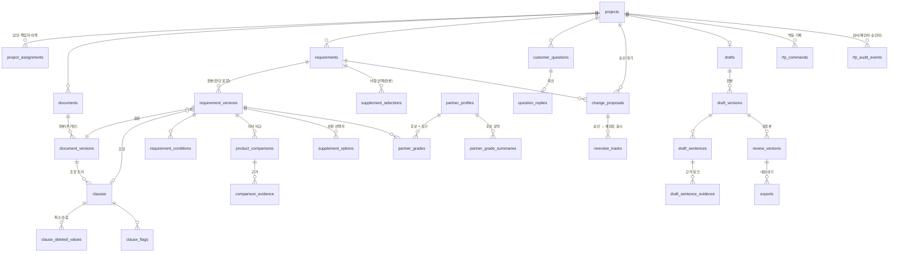

# RFP 자사 대응 데이터 구조와 API 골격 (KAN-182, A01)

원본 합의: [RFP 자사 대응·협력사 보완 API 명세 v1.1](https://docs.google.com/document/d/1lh6blP9IqACKvr3nyPp7NuU07jOmliIvIH_h87HDu9g)(2026-10-28, 기획서 최종본 수정본 4·6장). 이 문서는 그 명세의 §2.1 상태 값, §4.1 프로젝트 확장, §6 저장 구조를 코드로 옮긴 결과와 설계 이유다.

| 원본 | 파일 |
| --- | --- |
| 상태 값·HTTP 모델(OpenAPI 초안의 원본) | `backend/api/tft/rfp/schemas.py` |
| 경로 골격 28개(구현 전 501 `TFT_NOT_IMPLEMENTED`, OpenAPI `x-implementation-status: planned`) | `backend/api/tft/rfp/routes.py` |
| 저장 구조 | `infra/migrations/tft/20261029_KAN-182_rfp_response.sql` |
| 생성 OpenAPI | `docs/openapi/tft.json` |

**구현 범위 구분**: 이 PR은 데이터 구조·상태 값·경로 선언까지다. 경로 동작은 KAN-188(A07: 1~19·25·28·29)·KAN-189(A08: 20~24·26·27)·KAN-192(A12: 30)가 구현한다. 1·3번(목록·상세)은 기존 `projects/routes.py`에 있고 응답 확장(`RfpProjectSummary`·`RfpProjectDetail`)은 A07이 바꾼다.

## 왜 점수 하나 대신 네 가지 상태인가

요구 하나의 판단을 0~100 같은 적합도 점수 하나로 두지 않고 네 가지 상태로 둔다.

| 상태 | 뜻 | 다음 행동 |
| --- | --- | --- |
| `EVIDENCE_FOUND` 자사 대응 근거 있음 | 같은 속성·단위·조건으로 비교한 자사 근거가 있음 | 초안에 근거와 함께 쓴다 |
| `CONDITIONAL` 조건부 대응 검토 | 조건(온도 상승, 2차 전압 등)이 맞을 때만 대응 | 조건을 확인하거나 질문한다 |
| `SPEC_GAP` 사양 차이 확인 | 자사 근거가 요구와 다름(예: 15kV 요구에 12kV) | 보완 경로를 고른다 |
| `INSUFFICIENT_EVIDENCE` 판단 근거 부족 | 자료가 없거나 비교할 수 없음 | 자료를 요청하거나 질문한다 |

1. **평균이 필수 미충족을 숨긴다.** 필수 요구 하나가 사양 차이인데 나머지가 다 맞으면 점수는 높게 나온다. 그 하나가 입찰 탈락 사유다. 상태로 두면 미해결 필수 요구 수(`unresolved_mandatory_count`)가 따로 보인다.
2. **상태마다 다음 행동이 다르다.** 근거 부족이면 자료 요청, 조건부면 조건 확인·질문, 사양 차이면 보완 경로다. 점수 72와 68은 무엇을 해야 하는지 알려 주지 않는다.
3. **"자료 없음"과 "안 맞음"을 섞지 않는다.** 자료가 없는 것은 판단 근거 부족이지 미충족이 아니다. 점수로는 0점(근거 없음)과 0점(불충족)이 같아진다.
4. **사람이 확인·뒤집을 수 있다.** 상태와 사유(`reason`)·미확인 사항(`unresolved`)은 담당자가 읽고 변경 제안으로 바꿀 수 있다. 점수는 근거를 거슬러 설명하기 어렵다.

협력사 후보도 같은 원칙이다. 후보 × 요구마다 등급(`MANDATORY_CONFIRMED`·`REVIEW`·`REFERENCE_ONLY`·`EXCLUDED`)을 계산하고, 필수 제약을 어긴 후보는 점수와 무관하게 `EXCLUDED`다. 유사도 점수는 응답에 내지 않는다.

## 상태 값 (명세 §2.1)

| 구분 | 값 |
| --- | --- |
| 산출물 상태 `output_status` | `INTAKE`·`ANALYZING`·`REVIEW_DRAFT` (입찰 통과·수주와 별개) |
| 판단 상태 `judgement_status` | `NEEDS_REVIEW`·`CONDITION_CHECK`·`OWNER_CONFIRMED` (산출물 상태와 서로 대체하지 않음) |
| 요구 상태 `status` | `EVIDENCE_FOUND`·`CONDITIONAL`·`SPEC_GAP`·`INSUFFICIENT_EVIDENCE` |
| 요구 성격 `necessity` | `MANDATORY`·`PREFERRED`·`CONDITION_BOUND`·`UNDETERMINED` (요구 상태 `CONDITIONAL`과 다른 단어) |
| 보완 경로 `path` | `OTHER_OWN_PRODUCT`·`ALTERNATIVE_SPEC`·`EXTERNAL_PRODUCT`·`TASK_SUBCONTRACT`·`JOINT_PROPOSAL`·`NONE` |
| 부족 원인·고객 허용 | `RATING`·`CERTIFICATION`·`FORM`·`TASK` / `ALLOWED`·`FORBIDDEN`·`UNSTATED` |
| 후보 등급 `grade` | `MANDATORY_CONFIRMED`·`REVIEW`·`REFERENCE_ONLY`·`EXCLUDED` (KAN-187 `grading.Grade` 재사용) |
| 고객 질문 `status` | `OPEN`·`REPLIED` |
| 변경 제안 `origin`/`status` | `web`·`customer_reply`·`pdf_annot` / `PENDING`·`APPROVED`·`REJECTED` |
| 작업 `kind`/`step` | `rfp.process`·`rfp.export`·`rfp.annotate` / `parse`…`annotate` (플랫폼 `runtime.jobs`, owner=`tft`) |
| 출처 | `data_origin`(`synthetic`·`demo`·`real`, 기본값 없이 필수), `derivation_kind`(`PROVIDED`·`DERIVED`·`SYSTEM`·`ASSUMED`), `provenance_kind`(`ai_draft`·`human_input`·`system_record`) |

## ERD

## 저장 구조 (명세 §6)

| 묶음 | 표(`tft` 스키마) | 판본 | `tft_app`이 바꿀 수 있는 열 |
| --- | --- | --- | --- |
| 프로젝트 | `projects`(열 추가: `output_status`·`judgement_status`·`purpose`·`customer_goal`·`review_departments`·`review_version`), `project_assignments` | 프로젝트 `version` | 새 열 중 상태·목표·검토 부서·검토본 판본 |
| 문서 | `documents`, `document_versions`, `clauses`, `clause_deleted_values`, `clause_flags` | 문서 판본 | `documents.latest_version` |
| 요구 | `requirements`, `requirement_versions`(원문 위치·내용·판단), `requirement_conditions` | 요구 판본 | `requirements.latest_version` |
| 자사 비교 | `product_comparisons`, `comparison_evidence` | 요구 판본에 종속 | 없음 |
| 보완 경로 | `supplement_options`(계산), `supplement_selections`(사람 선택) | 선택 판본 | 없음 |
| 협력사 | `partner_profiles`(KAN-184 `profiles.json` 키, `synthetic`·`PROVIDED` 고정), `partner_grades`, `partner_grade_summaries`(KAN-187 출력, `DERIVED`) | 프로필 판본 | 없음 |
| 고객 질문 | `customer_questions`, `question_replies` | 질문 판본 | `status`·`version`·`updated_at` |
| 변경 제안 | `change_proposals` | 제안 판본 | `status`·`decided_by`·`decided_at`·`decision_note`·`version` |
| 초안·검토본 | `drafts`, `draft_versions`, `draft_sentences`, `draft_sentence_evidence`, `review_versions`, `exports` | 초안 판본 | `drafts.latest_version`, `exports`의 파일 열(완료 기록) |
| 재검토 표시 | `rereview_marks`(제안 승인 때 연결 요구·비교·보완·초안 문장마다 한 행) | — | `cleared_by`·`cleared_at`(사람이 다시 확인) |
| 멱등 기록 | `rfp_commands`(사용자·동작·`Idempotency-Key`마다 첫 결과) | — | 없음 |
| 감사 | `rfp_audit_events`(모든 쓰기, 승인은 제안자·승인자 함께) | — | 없음 |

- **모든 업무 행**에 `version`·`data_origin`·`derivation_kind`·`known_at`을 둔다(조항의 취소선 값·플래그·근거처럼 부모 행에 딸린 세부 행은 부모의 값을 따른다).
- **추가만**: 위 표에 `tft_app`은 SELECT·INSERT만 가지고 UPDATE·DELETE·TRUNCATE는 없다. 최신 판본 포인터와 상태 열만 열 단위 UPDATE를 연다. 판본을 고치지 않고 새 판본을 쓴다(명세 §2.3).
- **재검토 표시는 판본과 따로 둔다.** 판본 행은 고치지 않으므로 `needs_rereview` 열을 판본 표에 두지 않는다. 응답의 `needs_rereview`는 대상에 해소 안 된 `rereview_marks` 행이 있는지로 계산한다.
- **DB가 지키는 규칙**: 사람 판단 판본은 판단자·시각 필수, 비교 불가면 결과가 `NOT_COMPARABLE`/`NO_DATA`, 고객이 금지한 보완 경로는 `allowed=false`·사유 필수, 제외 사유가 있으면 등급 `EXCLUDED`, 조항에 못 맞춘 제안은 요구 없이 `clause_unresolved=true`, 사용자 제안은 제안자 필수, 기각은 사유 필수.
- **손대지 않은 것**: 기존 `projects.status`(옛 TFT 단계)와 CHECK, KAN-119의 인력 구성 표. 기존 `rfp_requirements`는 현재 상세 응답이 읽으므로 그대로 두고, 새 요구 표로 옮기는 일은 경로 구현(A07) 때 읽기 전환과 함께 한다.
- 작업 저장은 플랫폼 `runtime.jobs`를 owner=`tft`로 쓴다(명세 결정 4). 작업 종류 등록 마이그레이션과 내부 접수 엔드포인트는 플랫폼 쪽 후속 PR이다.

## 판본·동시 수정

쓰기 요청은 읽은 `version`을 본문에 보내고, 최신과 다르면 409 `TFT_VERSION_CONFLICT`다([API 계약](../../docs/api-contract.md#오류와-동시-수정)). 상태를 만드는 POST 12개는 `Idempotency-Key`(8~128자)가 필수이고 OpenAPI에 헤더로 선언돼 있다. 같은 사용자·동작·키의 재전송은 `rfp_commands`에 저장한 첫 결과를 돌려주고, 본문 hash가 다르면 409 `IDEMPOTENCY_CONFLICT`다. 요구의 상태·성격·조건·사유는 변경 제안 승인으로만 새 판본이 된다(승인 전 반영 금지). 예외는 사람의 결정 자체인 보완 선택과 초안 문장 수정이다.
