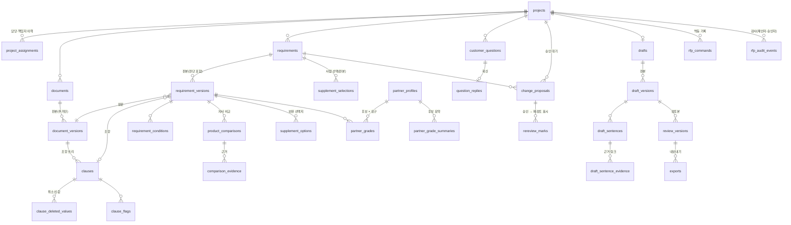

# RFP 자사 대응 데이터 구조와 API 골격 (KAN-182, A01)

원본 합의: [RFP 자사 대응·협력사 보완 API 명세 v1.1](https://docs.google.com/document/d/1lh6blP9IqACKvr3nyPp7NuU07jOmliIvIH_h87HDu9g)(2026-10-28, 기획서 최종본 수정본 4·6장). 이 문서는 그 명세의 §2.1 상태 값, §4.1 프로젝트 확장, §6 저장 구조를 코드로 옮긴 결과와 설계 이유다.

| 원본 | 파일 |
| --- | --- |
| 상태 값·HTTP 모델(OpenAPI 초안의 원본) | `backend/api/tft/rfp/schemas.py` |
| 경로 골격 5개(구현 전 501 `TFT_NOT_IMPLEMENTED`, OpenAPI `x-implementation-status: planned`). 15·16·18·19·20은 구현(KAN-189), 11·30 접수는 [작업 계약](rfp-jobs.md#tft-접수-경로-1130-kan-199kan-188) | `backend/api/tft/rfp/routes.py`, `routes_supplement.py`, `routes_questions.py`, `jobs.py` |
| 저장 구조 | `infra/migrations/tft/20261029_KAN-182_rfp_response.sql` |
| 생성 OpenAPI | `docs/openapi/tft.json` |

**구현 범위 구분**: 이 PR은 데이터 구조·상태 값·경로 선언까지다. 경로 동작은 KAN-188(A07: 1~19·25·28·29)·KAN-189(A08: 20~24·26·27)·KAN-192(A12: 30)가 구현한다. 1·3번(목록·상세)은 기존 `projects/routes.py`에 있고 응답 확장(`RfpProjectSummary`·`RfpProjectDetail`)은 A07이 바꾼다.

## 왜 점수 하나 대신 네 가지 상태인가

요구 하나의 판단을 0~100 같은 적합도 점수 하나로 두지 않고 네 가지 상태로 둔다.

| 상태 | 뜻 | 다음 행동 |
| --- | --- | --- |
| `EVIDENCE_FOUND` 자사 대응 근거 있음 | 같은 속성·단위·조건으로 비교한 자사 근거가 있음 | 초안에 근거와 함께 쓴다 |
| `CONDITIONAL` 조건부 대응 검토 | 조건(온도 상승, 2차 전압 등)이 맞을 때만 대응 | 조건을 확인하거나 질문한다 |
| `SPEC_GAP` 사양 차이 확인 | 자사 근거가 요구와 다름(예: 15kV 요구에 12kV) | 보완 경로를 고른다 |
| `INSUFFICIENT_EVIDENCE` 판단 근거 부족 | 자료가 없거나 비교할 수 없음 | 자료를 요청하거나 질문한다 |

1. **평균이 필수 미충족을 숨긴다.** 필수 요구 하나가 사양 차이인데 나머지가 다 맞으면 점수는 높게 나온다. 그 하나가 입찰 탈락 사유다. 상태로 두면 미해결 필수 요구 수(`unresolved_mandatory_count`)가 따로 보인다.
2. **상태마다 다음 행동이 다르다.** 근거 부족이면 자료 요청, 조건부면 조건 확인·질문, 사양 차이면 보완 경로다. 점수 72와 68은 무엇을 해야 하는지 알려 주지 않는다.
3. **"자료 없음"과 "안 맞음"을 섞지 않는다.** 자료가 없는 것은 판단 근거 부족이지 미충족이 아니다. 점수로는 0점(근거 없음)과 0점(불충족)이 같아진다.
4. **사람이 확인·뒤집을 수 있다.** 상태와 사유(`reason`)·미확인 사항(`unresolved`)은 담당자가 읽고 변경 제안으로 바꿀 수 있다. 점수는 근거를 거슬러 설명하기 어렵다.

협력사 후보도 같은 원칙이다. 후보 × 요구마다 등급(`MANDATORY_CONFIRMED`·`REVIEW`·`REFERENCE_ONLY`·`EXCLUDED`)을 계산하고, 필수 제약을 어긴 후보는 점수와 무관하게 `EXCLUDED`다. 유사도 점수는 응답에 내지 않는다. 문장 값(`TEXT`, 형식 포함)의 글자 불일치는 미달이 아니라 미확인이다. `EXCLUDED`는 숫자·규격·제약처럼 비교로 확인한 미달만 쓴다.

## 상태 값 (명세 §2.1)

| 구분 | 값 |
| --- | --- |
| 산출물 상태 `output_status` | `INTAKE`·`ANALYZING`·`REVIEW_DRAFT` (입찰 통과·수주와 별개) |
| 판단 상태 `judgement_status` | `NEEDS_REVIEW`·`CONDITION_CHECK`·`OWNER_CONFIRMED` (산출물 상태와 서로 대체하지 않음) |
| 요구 상태 `status` | `EVIDENCE_FOUND`·`CONDITIONAL`·`SPEC_GAP`·`INSUFFICIENT_EVIDENCE` |
| 요구 성격 `necessity` | `MANDATORY`·`PREFERRED`·`CONDITION_BOUND`·`UNDETERMINED` (요구 상태 `CONDITIONAL`과 다른 단어) |
| 보완 경로 `path` | `OTHER_OWN_PRODUCT`·`OWN_DEVELOPMENT`(자사 개발·수행 확인, R&D)·`OWN_TERMS_REVIEW`(자사 조건 변경 검토, 명세 추가 요청 중)·`ALTERNATIVE_SPEC`·`EXTERNAL_PRODUCT`·`TASK_SUBCONTRACT`·`JOINT_PROPOSAL`·`CUSTOMER_SPECIFIED_PROCUREMENT`(고객 지정품 조달)·`NONE` (명세 v1.3, 마이그레이션 T9) |
| 다음 담당 `next_owner_field` | `SALES`·`TECH`·`PURCHASE`·`CUSTOMER`·`RND`(R&D 자문 질문이 열린 요구, 명세 v1.3) |
| R&D 확인 `rnd_check`(요구 판본) | `NOT_REQUIRED`(기본)·`PENDING`·`CONFIRMED_FEASIBLE`·`CONFIRMED_NOT_FEASIBLE`·`CONFIRMED_SCHEDULE_MISMATCH`·`WAIVED` (마이그레이션 T10) |
| 질문 대상 `target` / `target_dept` | `CUSTOMER`(기본, v1.2 동작)·`INTERNAL`(부서 필수). 내부 자문 유형 `RND_FEASIBILITY`·`TECH_ADVICE`·`PURCHASE_TERMS`는 `INTERNAL`에만 |
| R&D 답변 | `rnd_feasibility` `FEASIBLE`·`FEASIBLE_WITH_SCHEDULE`·`NOT_FEASIBLE`·`UNDETERMINED`, `earliest_available_on`, `schedule_fits`(개발 가능성 없이 일정 칸만은 저장하지 않음) |
| 면제 사유 `rnd_check_waiver_reason`(보완 선택) | 20~1000자. 열린 R&D 질문이 있는 협력사 경로 선택에만 |
| 부서 분류 `tft.department_kinds` | `SALES`·`RND`·`TECH`·`PURCHASE`·`OTHER`. tft_app은 읽기만 |
| 전략 고객 `projects.strategic_customer`(+`_note`·`_set_by`·`_set_at`) | true·false·null(미입력). 영업 입력 표시값(가설)이고 상태·등급·경로 순위·검토본 조건·평가 입력에 쓰지 않는다. 값을 넣으면 넣은 사람·시각이 함께 있다(T11) |
| 통합 책임 `projects.integration_holder`(+`_candidates`·`_note`·`_set_by`·`_set_at`) | `OWN`·`SINGLE_PARTNER`·`JOINT`·`UNRESOLVED`(기본). 미확보가 아니면 정한 사람·시각이 있다. 필요 여부·근거 조항은 서버 계산([통합 책임](rfp-integration.md)) |
| 지정품 `requirement_versions.designated_manufacturer`·`designated_procurement`·`designated_clause_id` | 처리 방식 `SPECIFIED_PROCUREMENT`·`ALTERNATIVE_PROPOSAL`·`UNDECIDED`. `designated_model`(T7)이 있을 때만 값이 있다 |
| 선택의 R&D 확인 `supplement_selections.rnd_check` | 6값. 면제 사유는 `WAIVED`일 때만 |
| 감사 기록(앱 규칙, A07·A08) | 전략 고객·통합 책임 변경, INTERNAL 질문 생성·답변을 `audit_events`에 from/to로 남긴다 |
| 부족 원인·고객 허용 | `RATING`·`CERTIFICATION`·`FORM`·`TASK`·`DESIGNATED_MODEL`(타사 지정 모델)·`COMMERCIAL`(상업 조건)·`CORE_EQUIPMENT_MISSING`(핵심 기기 부재) / `ALLOWED`·`FORBIDDEN`·`UNSTATED` |
| 후보 등급 `grade` | `MANDATORY_CONFIRMED`·`REVIEW`·`REFERENCE_ONLY`·`EXCLUDED` (KAN-187 `grading.Grade` 재사용) |
| 고객 질문 `status` | `OPEN`·`REPLIED` |
| 변경 제안 `origin`/`status` | `web`·`customer_reply`·`pdf_annot` / `PENDING`·`APPROVED`·`REJECTED` |
| 작업 `kind`/`step` | `rfp.process`·`rfp.export`·`rfp.annotate` / `parse`…`annotate` (플랫폼 `runtime.jobs`, owner=`tft`) |

메모 PDF 해석(`rfp.annotate`, 경로30)은 지원 범위 밖으로 명시적 422이며 신규 UI 진입점을 제공하지 않는다.
과거 문서/작업 표현을 위해 enum은 유지한다. 일반 RFP 문서 PDF 입력은 계속 지원한다.

| 출처 | `data_origin`(`synthetic`·`demo`·`real`, 기본값 없이 필수), `derivation_kind`(`PROVIDED`·`DERIVED`·`SYSTEM`·`ASSUMED`), `provenance_kind`(`ai_draft`·`human_input`·`system_record`) |

## ERD

## 저장 구조 (명세 §6)

| 묶음 | 표(`tft` 스키마) | 판본 | `tft_app`이 바꿀 수 있는 열 |
| --- | --- | --- | --- |
| 프로젝트 | `projects`(열 추가: `output_status`·`judgement_status`·`purpose`·`customer_goal`·`review_departments`·`review_version`), `project_assignments` | 프로젝트 `version` | 기존 KAN-119 권한 그대로(표 전체 UPDATE). 상태 두 개는 서버 규칙으로만 바꾼다(앱이 지킴, 권한 축소는 Z 단계) |
| 문서 | `documents`, `document_versions`, `clauses`, `clause_deleted_values`, `clause_flags` | 문서 판본 | `documents.latest_version` |
| 요구 | `requirements`, `requirement_versions`(원문 위치·내용·판단), `requirement_conditions` | 요구 판본 | `requirements.latest_version` |
| 자사 비교 | `product_comparisons`, `comparison_evidence` | 요구 판본에 종속 | 없음 |
| 보완 경로 | `supplement_options`(계산), `supplement_selections`(사람 선택) | 선택 판본 | 없음 |
| 협력사 | `partner_profiles`(KAN-184 `profiles.json` 키, `synthetic`·`PROVIDED` 고정), `partner_grades`, `partner_grade_summaries`(KAN-187 출력, `DERIVED`) | 프로필 판본 | 없음 |
| 고객 질문 | `customer_questions`, `question_replies` | 질문 판본 | `status`·`version`·`updated_at` |
| 변경 제안 | `change_proposals` | 제안 판본 | `status`·`decided_by`·`decided_at`·`decision_note`·`version` |
| 초안·검토본 | `drafts`, `draft_versions`, `draft_sentences`, `draft_sentence_evidence`, `review_versions`, `exports` | 초안 판본 | `drafts.latest_version`, `exports`의 `job_id`(접수 뒤)·파일 열(완료 기록) |
| 재검토 표시 | `rereview_marks`(제안 승인 때 연결 요구·비교·보완·초안 문장마다 한 행) | — | `cleared_by`·`cleared_at`(사람이 다시 확인) |
| 멱등 기록 | `rfp_commands`(사용자·동작·`Idempotency-Key`마다 첫 결과) | — | 없음 |
| 감사 | `rfp_audit_events`(HTTP 쓰기). `commands.remember`가 멱등 쓰기·처리 접수를 기록하고(`proposal.approve`·`proposal.reject`는 제안자·결정자와 함께 경로가 기록), 멱등 키가 없는 4·5와 쓰기의 부수 행(회신 제안, R&D 자동 질문)은 `commands.audit`을 직접 부른다. 재전송은 다시 기록하지 않는다. 멱등 쓰기의 detail은 쓰기 뒤 상태(`to`)만, 4·5는 `from`·`to`다. worker가 쓰는 행은 접수 감사(`job`)로 대신한다 | — | 없음 |

- **읽기 경로(KAN-188, `rfp/routes_read.py`)**: 7~10·12~14·17이다. 범위 밖은 없는 것과 같이 404다(`TFT_PROJECT_NOT_FOUND`·`TFT_DOCUMENT_NOT_FOUND`·`TFT_REQUIREMENT_NOT_FOUND`).
  - 문서 경로 8~10은 문서의 최신 판본 기준이다. 목록(7)은 판본 전부다.
  - 조항(9)은 `parent`가 없으면 전체 조항을 문서 순서(`ordinal`)로 낸다. 화면이 `parent_clause_id`로 트리를 만든다.
  - 원문(10)은 항상 `attachment`·`nosniff`이고, 저장 해시·크기가 맞을 때만 낸다. 저장소(`TFT_DOCUMENT_BUCKET` 또는 `TFT_DOCUMENT_ROOT`)가 없거나 읽지 못하면 503 `TFT_DOCUMENT_UNAVAILABLE`이다.
  - 요구 목록(12) 기본 순서는 상태(`SPEC_GAP`→`CONDITIONAL`→`EVIDENCE_FOUND`→`INSUFFICIENT_EVIDENCE`), 같은 상태 안에서는 조항 자연 순서(`2.9` 다음 `2.10`, `1.1.A` 다음 `1.1.A.4.a`), 순번이다. 커서는 정렬과 같은 값을 비교하고 상태 순위를 담아, 쪽을 넘기는 사이 상태가 바뀌어도 위치가 밀리지 않는다. 코드만 담은 옛 커서는 400 `TFT_INVALID_CURSOR`다.
  - 요구 목록(12)의 필터는 모두 SQL에서 걸어 쪽이 어긋나지 않는다. `open_questions`는 `OPEN`만 센다(`DRAFT` 제외).
  - `tolerance`(원문 표기, `spec`)와 `needs_review`(시스템 표시, 목록·상세 최상위)는 T15 칸이다. `tolerance`의 `null`은 '오차 없음'이 아니라 '없거나 모름'이다(T15 전 판본은 재처리 전까지 `null`·`false`). `attribute_key`·`equipment_family`는 저장만 하고 응답에 내지 않는다.
  - `links.comparison_summary`는 후보 수와 결과 요약, `links.supplement_summary`는 최신 선택의 경로 코드다. 화면 표시용 자유 문자열이다.
  - 비교(14)는 비교가 저장된 가장 최근 요구 판본을 내고 그 판본을 `requirement_version`에 적는다. 후보가 없으면 저장 행이 없으므로 저장된 `equipment_family`로 `search_trace.filters`를 만든다(`family=…`, 모르면 `family=NONE`).
  - 협력사 후보(17)는 저장된 등급 행이 있는 후보만 낸다. `overall_grade`는 `grading.overall_grade`로 저장 등급 전체에서 계산하고(`partner_grade_summaries`는 쓰지 않음), `requirement_id` 필터는 `grades`만 좁힌다. `conditions_to_confirm`은 `mandatory_check.unknown` 합집합, `on_customer_manufacturer_list`는 최신 프로젝트의 사람 입력 제조사 목록 기준이며 미제공이면 `null`이다. 이 값은 저장 등급 판정 시점과 별개다. 응답의 `manufacturer_list_basis=CURRENT_PROJECT_INPUT`·`input_project_version`으로 구분하고, 요구별 등급의 추가 필드 `requirement_version`·`profile_version`·`version`·`known_at`은 실제 저장 판정의 판본·시점을 나타낸다. 기존 필드는 삭제하거나 의미를 바꾸지 않는다.
- **쓰기 경로(KAN-188, `rfp/routes_write.py`)**: 2·4·5·6이다. 응답은 `RfpProjectDetail`이다.
  - 2 접수: `sales`만. 호출자가 담당이 되고 책임자는 자동 지정하지 않는다. `review_departments`는 `department_kinds`에 있어야 한다.
  - 4 수정: 담당 `sales`·책임자만. 본문에 있는 칸만 바꾼다. `name`·`review_departments`·`integration_responsibility`의 `null`은 422, `strategic_customer: null`은 입력자·메모와 함께 지운다.
  - 5 지정: 관리 대상 `manager`만(범위 밖 404, 볼 수만 있으면 403). 호출마다 `project_assignments` 한 행이다. 다른 manager의 관리 범위는 tft가 읽지 못해 책임자 후보는 새 담당 `sales`·기존 책임자·호출한 manager다. `sales_user_id`는 검증하지 않는다: identity를 읽지 못하므로 없는 사용자나 `sales` 역할이 없는 ID도 들어간다.
  - 6 업로드: 담당 `sales`·책임자만. 25 MiB 초과 413 `TFT_DOCUMENT_TOO_LARGE`(Content-Length가 없어도 받는 동안 멈춘다). 형식은 내용으로 판별한다(PDF는 `%PDF-`, DOCX는 zip 안 `word/document.xml`). 다음 판본은 같은 프로젝트·같은 `kind`만 되고 제목·메모는 첫 판본 것을 유지한다. 저장소가 없으면 503 `TFT_DOCUMENT_UNAVAILABLE`이다.
  - 원문은 `rfp/{project_id}/{document_version_id}`에 쓴 뒤 DB를 커밋한다. DB 실패 시 객체가 남을 수 있다(실행 계정에 삭제 권한이 없다).
- **변경 제안(KAN-189, `rfp/routes_proposals.py`)**: 21~24다. 작성은 담당 `sales`·책임자·검토 부서 `dept_staff`, 승인·기각은 담당 `sales`·책임자다. 범위 밖은 404 `TFT_PROPOSAL_NOT_FOUND`다.
  - 22는 값이 온 칸만 바꾸고 나머지는 지금 판단을 이어 `proposed`에 전체를 저장한다. 바뀌는 칸이 없으면 422다. 다만 코드가 건 `needs_review` 요구는 값을 그대로 두는 확인 제안을 받는다(새 경로·새 칸 없음, `proposed`가 빈 객체여도 된다).
  - 23은 제안의 `base_requirement_version`이 최신일 때만 새 판본(`human_input`, `proposal_id`)을 쓴다. 다르면 409 `TFT_VERSION_CONFLICT`로, 다시 제안해야 한다(기각은 된다). 요구 없는 메모 제안의 승인은 422, 이미 결정한 제안은 409 `TFT_PROPOSAL_DECIDED`다.
  - 새 판본은 판단 칸만 바꾸고 나머지 칸은 잇는다. `needs_review`는 잇지 않고 `false`로 쓴다: 사람이 승인한 판본이라 코드 경고가 끝난다. 사람이 판단한 기록은 판본의 `proposal_id`·`decided_by`와 감사 `proposal.approve` 상세의 `needs_review_confirmed`다. 비교·보완 선택지는 새로 만들지 않고 그 요구의 가장 최근 저장 판본을 읽는다.
  - 승인은 요구·비교·보완·최신 초안 문장마다 `rereview_marks` 한 행을 남긴다. 값이 그대로인 확인 승인은 볼 변화가 없어 남기지 않는다(승인 결과가 `EVIDENCE_FOUND`이거나 고를 수 있는 보완 경로가 없으면 요구 표시는 남기지 않는다: 요구 표시는 보완 저장으로만 풀려서, 조건부·경로 없는 근거 부족에 남기면 그 요구를 근거로 든 문장이 영구히 막힌다. 비교·보완·초안 문장 표시는 남긴다). 또한 감사에 제안자·승인자를 함께 적는다.
  - 24 기각은 요구를 바꾸지 않는다. 감사 `proposal.reject`에 승인과 같이 제안자·결정자(`approver_user_id`)를 적고, 상세에 쓰기 뒤 상태(`to`)·바꾸지 않은 제안값(`proposed`)·사유(`reason`)를 둔다(KAN-153). 제안 응답·목록(21·22·24)의 `decision_note`는 승인 메모 또는 기각 사유이고, 결정 전이거나 메모 없는 승인이면 null이다.
  - **재검토 해소**: 해소 경로는 따로 없다. 같은 요구의 보완 선택을 다시 저장(경로 16)하면 사람이 다시 확인한 것으로 보고 요구·비교·보완 표시를 해소한다. 초안 문장 표시는 지우지 않는다. 초안 문장은 사람이 고쳐 저장(`PATCH draft`)하면 그 문장만 풀린다(명세 결정 10). 근거 요구에 재검토가 남아 있으면 응답의 `needs_rereview`는 그대로다. **한계**: `EVIDENCE_FOUND`가 아닌데 보완 경로를 고를 수 없는 요구는 표시를 해소할 수 없어 `needs_rereview`와 미해결 필수 집계에 남는다.
- **경로 1·3(KAN-188)**: 명세 칸을 더했다. 목록은 `output_status`·`judgement_status`·`q`(이름·고객명 부분 일치, 대소문자 무시, 2~100자, `%`·`_`는 글자 그대로) 필터와 상태 2개·건수 4개(`requirements_count`·`unresolved_mandatory_count`·`pending_proposals_count`·`open_questions_count`)를 준다. 건수는 `repository.PROJECT_COUNTS` 한 문장으로 계산하고 목록과 상세가 같이 쓴다. `open_questions_count`는 프로젝트의 `OPEN` 질문 전부다(요구 없는 질문 포함, `DRAFT` 제외). 옛 칸(`status`·`external_id`·`rfp_requirements`)은 화면이 바뀔 때까지 남긴다. 상세와 쓰기 응답의 `latest_job`은 최신 처리 접수(`rfp_commands`의 `project.process`)의 `job_id`만 있고 `status`·`step`은 null이다(`JobRef.status`는 null 허용, 목록에는 이 칸이 없다). 상태는 플랫폼 소유라 화면이 작업 상태 경로로 읽는다. 그 경로는 요청한 사용자에게만 열린다. `output_status`는 플랫폼에 접수를 보내기 전에 `ANALYZING`이 되고, 접수가 안 되면 이전 값으로 돌아간다(worker가 응답보다 먼저 끝나도 덮어쓰지 않게). 성공하면 검토본 저장 전까지 그대로이고 `REVIEW_DRAFT`는 검토본 저장이 정한다. worker가 실패·취소로 끝내면 `INTAKE`로 돌린다(저장된 검토본이 있으면 `REVIEW_DRAFT`). **한계**: 플랫폼이 `JOB_NOT_STARTED`로 닫은 작업은 tft를 건드릴 수 없어 `ANALYZING`이 남고, 다음 접수가 다시 `ANALYZING`으로 만든다. 첫 접수 둘이 동시에 들어오면 거절된 쪽이 표시를 이전 값으로 되돌려, 작업이 도는 동안 값이 틀릴 수 있다.
- **지정품 상세(KAN-199 댓글 10926)**: 처리 함수가 지정 모델이 있는 요구에 `designated_clause_id`(요구의 조항)와 `designated_procurement`(시작값 `SPECIFIED_PROCUREMENT`)를 저장한다. 이 칸이 비어 있는 이전 행은 상세 응답에서 요구 조항과 기본값으로 낸다.
- **웹 중계(KAN-188)**: 구현한 RFP 경로는 `backend/api/platform/relay.py`·`frontend/server.mjs` 허용표와 공유 픽스처 `docs/openapi/business-relay-routes.json`에 함께 등록한다(셋이 다르면 검사가 실패한다). 파일이 지나가는 두 경로만 JSON·1 MiB 규칙의 예외다: 업로드(6)는 `multipart/form-data` 요청 26 MiB, 원문(10)은 PDF·DOCX 응답 26 MiB이고 `attachment`·`nosniff`를 중계가 강제한다. 세션·CSRF·Origin 검사와 사용자 헤더 재발급은 같고, 원문 범위(manager는 관리 대상 프로젝트만)는 tft가 판단한다. 두 층이 파일을 메모리에 모으므로 동시 업로드 수만큼 메모리를 쓴다. 업로드 외 쓰기 요청은 `application/json`만 받으므로 본문이 없는 경로 31도 화면은 `{}`를 보낸다. 처리 작업 `status_url`(`/api/v1/platform/jobs/{id}`, `/events`)은 플랫폼 자체 경로라 허용표가 아니라 웹의 작업 상태 중계로 열리고(업무 중계를 켜면 함께 열림), 접근은 플랫폼이 요청 사용자 본인으로 검사한다.
- **질문 초안(KAN-199)**: 처리 함수가 `generate_question_drafts` 결과를 조항·요구와 같은 트랜잭션에서 `customer_questions`에 `DRAFT`로 넣는다(`CUSTOMER`, `DERIVED`, 요청자가 `created_by`). `draft_key`(종류와 조항 번호·원문의 sha256)로 프로젝트 안 같은 질문을 한 번만 만든다. 조항 ID는 판본마다 달라 키에 쓰지 않고, 미정 항목 문구는 조항과 무관해 문구도 쓰지 않는다. 종류 매핑은 `PLACEHOLDER`→`EMPTY_VALUE`, `INCONSISTENCY`→`CONFLICT`, `APPROVAL_PROCESS`→`CONDITION_MISSING`이고, 회신 전 메모는 `internal_assumption.value`, 출처 조항은 `basis_clause`다. `requirement_id`는 같은 조항에서 인용이 출처 원문과 같거나 서로 포함되는 요구가 정확히 하나일 때만 연결하고, 없거나 갈리면 NULL이다. `DRAFT`는 보낸 질문이 아니다: 목록에 상태로 구분되고, `has_customer_question`에서 빠지며, 회신은 409다. 사람이 경로 31(`POST .../questions/{id}/confirm`)로 `OPEN`으로 바꾼다. `OPEN`·`REPLIED`에 부르면 409 `TFT_VERSION_CONFLICT`이고 같은 멱등 키 재전송은 첫 결과를 준다.
- **협력사 프로필 시드(KAN-184)**: `profiles.json`이 원천이고 `scripts/rfp_seed_partner_profiles.py`가 `tft.partner_profiles`로 옮긴다. 기본과 `--dry-run`은 합성 프로필 검증·계획(`PLANNED`)만 출력하며 DB 접속·쓰기는 0이다. `--check`는 환경변수 `DATABASE_URL`로 명시 읽기 전용 대조(`SET TRANSACTION READ ONLY`, `SAME`·`MISSING`·`DIFFERENT`, 차이가 있으면 종료 1)한다. 공용 환경도 지원하되 적용은 **운영자 터미널**에서 `--apply`를 명시할 때만 한다(기존 `--execute`는 같은 검증을 거치는 별칭). 적용은 출력된 `host=<host> port=<port> dbname=<DB>` 토큰을 `--confirm-target` 한 인자로 정확히 다시 제공해야 접속한다. 확인 누락/불일치도 대상은 출력하되 접속 0회다. DSN에 단일 host·DB를 명시해야 하며 service/hostaddr·다중 host/port·제어문자·모호한 대상은 접속 전에 거부한다. 명시한 port(없으면 PGPORT 또는 5432)까지 확인하고 connect에도 검증한 host/port/DB를 명시한다. 확인 옵션은 apply/execute에서만 허용한다. dry-run/check/apply는 서로 동시에 지정할 수 없다. `data_origin`·`profile_source`가 `synthetic`인 입력만 접속·INSERT 전에 허용한다. DSN·암호·원문·드라이버 예외는 출력하지 않는다. 적용은 없는 판본만 넣고(`ON CONFLICT DO NOTHING`) 기존 같은 판본을 덮어쓰거나 삭제하지 않는다. 내용이 바뀌면 `profile_version`을 올린다. `known_at`은 그날 00:00 UTC다. 행이 없으면 RFP 처리 함수의 등급 단계는 건너뛴다. 이 구현 검증에서는 fake 연결만 사용하며 공용 DB 적용·운영 스크립트 실행은 하지 않는다.
- **모든 업무 행**에 `version`·`data_origin`·`derivation_kind`·`known_at`을 둔다. 예외는 업무 판단이 아니라 사람 행동·시스템 기록이거나 부모 판본에 딸린 행이며, 출처는 부모 또는 행위자·시각 열로 대신한다.
  - 부모를 따르는 세부 행: `clause_deleted_values`·`clause_flags`(조항), `comparison_evidence`(비교), `draft_sentences`·`draft_sentence_evidence`(초안 판본), `requirement_conditions`(요구 판본)
  - 사람 행동 기록(행위자·시각 열): `project_assignments`, `review_versions`, `exports`, `rereview_marks`
  - 시스템 기록: `rfp_commands`(멱등), `rfp_audit_events`(감사)
- **추가만**: 위 표에 `tft_app`은 SELECT·INSERT만 가지고 UPDATE·DELETE·TRUNCATE는 없다. 최신 판본 포인터와 상태 열만 열 단위 UPDATE를 연다. 판본을 고치지 않고 새 판본을 쓴다(명세 §2.3).
- **재검토 표시는 판본과 따로 둔다.** 판본 행은 고치지 않으므로 `needs_rereview` 열을 판본 표에 두지 않는다. 응답의 `needs_rereview`는 기존 미해소 표시·선택 이후 R&D 회신과 함께, 최신 보완 선택이 현행 요구/후보 등급에 맞는지를 공용 식으로 확인한다. 가짜 원인 제안이나 표시 행을 만들지 않는다.
  - 요구의 `needs_rereview`는 위 조건에 하나를 OR로 더한다(KAN-189): 그 요구의 INTERNAL R&D 자문 답변(`issue_type=RND_FEASIBILITY`) 기록 시각이 최신 보완 선택(`supplement_selections.decided_at`)보다 뒤면 참이다. 보완 선택이 없으면 이 조건은 보지 않고, 새 선택이 생기면 꺼진다. R&D 답변은 변경 제안을 만들지 않으므로(명세 v1.3 §5.3) 제안에 묶인 `rereview_marks` 행을 남길 수 없어 계산으로 둔다. 구현은 `backend/api/tft/rfp/repository.py`의 `needs_rereview`다.
  - 후속 제안(KAN-182): 답변을 표시 원인으로 저장하려면 `rereview_marks`에 `cause_question_id`(질문 FK, `cause_proposal_id`와 둘 중 하나)를 허용하는 확장이 필요하다. 그때까지는 위 계산이 원천이다.
- **R&D 확인 `rnd_check`는 읽을 때 계산한다(KAN-189).** 원천은 `rnd.rnd_check_of(그 요구의 R&D 자문 질문·답변, WAIVED로 저장된 최신 보완 선택의 결정 시각)`이다(`repository.rnd_check`). 이 값을 바꾸려고 요구 판본을 새로 쓰거나 제자리 갱신하지 않는다. 비교·보완 선택지가 요구 판본에 묶여 있어 판본만 올리면 최신 판본의 비교가 비기 때문이다. `requirement_versions.rnd_check`(T10)는 다른 흐름이 판본을 새로 만들 때만 그 시점 값으로 채운다. 보완 선택 판본의 `rnd_check`는 선택 시점의 값(면제면 `WAIVED`)을 남긴다.
- **DB가 지키는 규칙**: 질문·제안·후보 등급의 요구는 같은 프로젝트 요구만 가리킨다((project_id, requirement_id) 복합 참조), 사람 판단 판본은 판단자·시각 필수, 비교 불가면 결과가 `NOT_COMPARABLE`/`NO_DATA`, 고객이 금지한 보완 경로는 `allowed=false`·사유 필수, 제외 사유가 있으면 등급 `EXCLUDED`, 조항에 못 맞춘 제안은 요구 없이 `clause_unresolved=true`, 사용자 제안은 제안자 필수, 기각은 사유 필수.
- **판본 유일 키**(`20261030_KAN-182_rfp_keys.sql`): 비교·보완 선택지·후보 등급·후보 요약은 같은 대상의 같은 `version`을 한 번만 저장한다. 다시 계산할 때는 version을 늘린다. 재검토 표시의 원인 제안은 같은 프로젝트 제안만 가리킨다.
- **앱이 검사하는 프로젝트 소속**: 아래 참조는 DB가 프로젝트 일치를 보증하지 않는다. 경로 구현(KAN-188·189)이 쓰기 전에 같은 프로젝트인지 확인하고, 다르면 404로 처리한다.
  - `requirement_versions.document_version_id`·`clause_id`
  - `customer_questions.clause_id`
  - `supplement_options.permission_clause_id`
  - `rereview_marks.target_id`
  - 근거 링크(`comparison_evidence`·`draft_sentence_evidence`)
  - 복합 참조로 바꾸려면 `document_versions`·`clauses`에 `project_id`를 복제해야 해서 두지 않았다.
- **손대지 않은 것**: 기존 `projects.status`(옛 TFT 단계)와 CHECK, KAN-119의 인력 구성 표. 기존 `rfp_requirements`는 현재 상세 응답이 읽으므로 그대로 두고, 새 요구 표로 옮기는 일은 경로 구현(A07) 때 읽기 전환과 함께 한다.
- 작업 저장은 플랫폼 `runtime.jobs`를 owner=`tft`로 쓴다(명세 결정 4). 작업 종류 등록 마이그레이션과 내부 접수 엔드포인트는 플랫폼 쪽 후속 PR이다.

## 인증

모든 RFP 경로는 라우터 단위 의존성(`rfp_principal`)으로 사용자 맥락(없으면 401)과 TFT 역할(cs_agent는 403)을 먼저 검사한다. 구현 전 501보다 앞선다. 프로젝트 범위(404)는 경로마다 구현 티켓이 검사한다.

## 판본·동시 수정

문서의 새 판본은 업로드 입력 `supersedes_document_id`로 기존 문서를 지정해 올린다. 별도 대체 관계 열을 두지 않고 같은 `document_id` 아래 `document_versions.version`이 하나 늘어난 행으로 저장한다(다른 프로젝트 문서는 404). 원문 판본이 바뀐 요구는 새 문서 판본을 가리키는 새 요구 판본으로 쌓인다.

쓰기 요청은 읽은 `version`을 본문에 보내고, 최신과 다르면 409 `TFT_VERSION_CONFLICT`다([API 계약](../../docs/api-contract.md#오류와-동시-수정)). 상태를 만드는 POST 12개는 `Idempotency-Key`(8~128자)가 필수이고 OpenAPI에 헤더로 선언돼 있다. 같은 사용자·동작·키의 재전송은 `rfp_commands`에 저장한 첫 결과를 돌려주고, 본문 hash가 다르면 409 `IDEMPOTENCY_CONFLICT`다. 요구의 상태·성격·조건·사유는 변경 제안 승인으로만 새 판본이 된다(승인 전 반영 금지). 예외는 사람의 결정 자체인 보완 선택과 초안 문장 수정이다.

## 경로 15·16·18·19·20 동작 (KAN-189)

- **범위**: 프로젝트를 볼 수 없으면(`can_view_rfp`: 담당·관리 범위 또는 검토 부서 `dept_staff`) 없는 것과 같은 404(`TFT_PROJECT_NOT_FOUND`·`TFT_REQUIREMENT_NOT_FOUND`·`TFT_QUESTION_NOT_FOUND`)다. 볼 수는 있지만 쓸 수 없으면 403이다. 질문 작성은 담당 sales·책임자·검토 부서 `dept_staff`, 보완 선택은 담당 sales·책임자, 회신은 CUSTOMER면 담당 sales이고 INTERNAL이면 `target_dept` `dept_staff`·담당 sales·책임자다(`projects/access.py`).
- **멱등**: 쓰기 셋(`question.create`·`question.reply`·`supplement.select`)은 `commands.run_command`가 한 트랜잭션에서 기록 재생 → 처리 → 결과 기록을 한다. 판본 409 같은 상태 검사는 처리 안쪽에 있어 재전송은 상태가 바뀐 뒤에도 첫 결과를 받는다. 같은 키가 동시에 처리돼 결과 기록이 기본 키에 걸리면 409 `IDEMPOTENCY_CONFLICT`다(트랜잭션이 중단돼 다시 읽을 수 없다. 다시 보내면 먼저 끝난 결과를 재생한다). 늦은 쪽이 기록 전에 같은 질문 행 잠금을 기다렸다면(20 회신) 먼저 끝난 쪽이 바꾼 판본을 보고 409 `TFT_VERSION_CONFLICT`가 날 수 있다. 어느 409든 데이터는 롤백되고, 같은 키로 다시 보내면 첫 결과를 재생한다.
- **묶음 작성·선택(검토 대상 묶음)**: `POST /projects/{id}/questions/batch`(질문 1~50건, 모든 건에 `requirement_id`)와 `POST /projects/{id}/supplement-selections/batch`(같은 선택을 요구 1~50건에, 건마다 읽은 `version`)는 단건 19·16과 같은 인증·CSRF·권한을 쓰고 건별 검사도 같은 함수(`check_question`·`apply_selection`)를 부른다. 앱은 메일을 보내지 않는다: 질문은 앱 안 기록이고 보낸 뒤 회신은 기존 20이 기록한다. 멱등 연산 이름은 단건과 같은 `question.create`·`supplement.select`다(표 CHECK를 늘리지 않으려는 선택, 본문 해시가 달라 단건과 같은 키를 쓰면 409). 질문 묶음은 한 트랜잭션이고 한 건이라도 어긋나면 아무것도 저장하지 않고 422 `VALIDATION_ERROR`에 `details: [{index, code, message}]`(index는 0부터, 문자열)를 준다. 선택 묶음은 건마다 savepoint 안에서 돌려 막힌 건은 `blocked`(`code`·`message`는 단건 오류와 같다)로 알리고 나머지를 저장한다: `dry_run=true`는 같은 검사를 돌린 뒤 되돌려 키 없이 `allowed`만 채우고(200), 저장하면 키가 필요하고 하나라도 저장하면 201, 없으면 200이다. 건별 감사와 재검토 해소는 단건과 같다.
- **15 선택지**: 최신 요구 판본의 `supplement_options` 행에서 부족 원인·고객 허용·허용 조항·경로별 후보만 읽는다. 순위·게이트·차단은 저장된 `allowed`·순위를 쓰지 않고 `supplement.options_for`(판단 상태·원인, 허용, `designated_model` 유무, 지금의 `rnd_check`, 그 요구의 고객 질문 유무)로 다시 계산한다. 그래서 R&D 답이 오면 협력사 경로 차단이 바로 보인다. 저장 행이 없으면 원인 없음·허용 `UNSTATED`로 계산한다(지정품만 경로가 나온다).
- **보드 칸(KAN-188)**: 경로 12 항목에 `attribute_key`(비교 어휘 키, 원문은 `attribute`)와 `provenance_kind`를 더했다. 경로 13은 `spec.attribute_key`로 같은 키를 낸다. 필터는 10개다: `document_version_id`, `equipment`, `task`, `necessity`, `status`, `needs_rereview`, `needs_review`, `has_open_question`, `next_owner_field`, `unresolved_mandatory`(요구 건수의 미해결 필수와 같은 판정, `false`는 그 나머지). 경로 2는 `external_id`를 `P<연도 두 자리>-<순번 4자리>`로 발급한다. 연도는 한국 시각, 순번은 웹 접수(`source=rfp`, `source_instance=web`) 안에서 연도마다 새로 세고 동시 접수는 advisory lock으로 줄 세운다. 이전 프로젝트는 null이다. 표시 이름은 tft가 identity를 읽지 못해 화면이 `GET /api/v1/platform/users?ids=<쉼표로 이은 UUID, 최대 100>`로 묶어 읽는다. 로그인만 요구하고 ID·표시명만 낸다.
- **15 근거 부족(KAN-188)**: `INSUFFICIENT_EVIDENCE` 요구에 제외되지 않은 등급의 후보가 있으면 `EXTERNAL_PRODUCT`를 낸다(기획서 시연 B-2). 자사 비교 후보가 있는 인증 요구이고 고객 허용이 `FORBIDDEN`이 아니면 `ALTERNATIVE_SPEC`도 낸다(둘 다 순위 3, 이 순서). 판본에 추출 `kind`가 없어 인증 요구는 `operator=TEXT`, `standard_system≠NONE`, `attribute_key`가 없거나 `OTHER`인 요구로 읽는다. 처리는 등급보다 먼저 선택지를 저장하므로 `EXTERNAL_PRODUCT` 후보 코드는 판단 상태와 상관없이(사양 차이 포함) 저장 행이 비었을 때 `partner_grades`에서 읽는다. R&D 게이트와 RFP 금지는 그대로다. 지정품·수행 과업·계약 조건 규칙은 먼저 적용돼 바뀌지 않는다.
- **16 선택**: 읽은 요구 판본이 최신과 다르면 409 `TFT_VERSION_CONFLICT`다. 그 뒤 15와 같은 계산의 선택지로 `rnd.check_selection`을 한다. 면제로 넘긴 선택에만 사유를 남긴다. `OWN_DEVELOPMENT`를 고르면 열린 R&D 질문이 없을 때 `rnd.rnd_question_for`의 내부 질문을 같은 트랜잭션에서 만들고 선택 판본의 `rnd_check`는 `PENDING`이다.
- **16 자사 개발(KAN-188)**: `OWN_DEVELOPMENT`를 고르면 질문을 만든다. 열린 R&D 질문이 있거나 답이 `CONFIRMED_FEASIBLE`이면 만들지 않는다. 답을 받은 뒤 같은 경로를 다시 저장해 재검토를 푸는 흐름이다. 답이 `CONFIRMED_NOT_FEASIBLE`이면 `OWN_DEVELOPMENT`는 `allowed=false`, `blocked_reason=OWN_DEVELOPMENT_NOT_FEASIBLE`이다. 다시 보려면 사람이 새 R&D 질문을 쓴다. 초안 생성은 막히거나 사라진 경로의 선택을 결정으로 쓰지 않는다.
- **9 조항(KAN-188)**: 경로의 ID는 문서 ID 또는 문서 판본 ID다. 판본 ID면 그 판본의 조항이다. 요구 화면이 인용한 판본으로 부른다.
- **19 질문**: INTERNAL의 `target_dept`가 프로젝트 검토 부서 밖이거나 원문 조항이 프로젝트 문서의 조항이 아니면 422 `VALIDATION_ERROR`다.
- **16 후보 검사**: 고른 `candidate_codes`는 그 경로의 저장 후보여야 한다(밖이면 422 `VALIDATION_ERROR`). 이 요구의 최신 저장 등급이 `EXCLUDED`인 후보는 422 `TFT_CANDIDATE_EXCLUDED`다(경로 후보여도 거절). 거절된 코드는 `details`에 적는다.
- **20 회신**: 응답과 질문 목록에 `reply`(본문, 출처, 수신·기록 일시, 기록자, R&D 가능 여부·일정)를 제공한다. 회신 저장은 요구의 미해결 항목을 해소하거나 제안을 자동 생성하지 않는다. 질문 문자열 포함 여부로 해결을 추정하던 계약은 폐기했다. `created_proposal`은 호환 필드로 null이다.
- **22 명시적 회신 반영**: `source_question_id`로 같은 프로젝트·요구에 저장된 회신을 지정한다. `requirement_version`을 주면 해당 판본과 일치해야 한다(409). `source_ref={question_id,reply_id}`와 `evidence_refs`를 제안에 보존한다. `proposed.spec={value,unit,operator,tolerance}` 및 기존 `conditions`, `unresolved`를 사람이 명시한다. 승인 전 요구는 바뀌지 않고, 승인 시 새 요구 판본을 만들며 원문 인용을 보존한다. 사양 변경 시 옛 정규값은 지워 다시 확인하게 한다.
- **해당 요구 재비교**: `POST /requirements/{id}/recompare`, `{version}`, Idempotency-Key 필수. 저장된 추출 의미와 합성 자사 사양의 순수 비교기를 사용하며 모델·문서 재처리는 없다. 과거 추출 의미가 없거나 유효하지 않으면 409 `TFT_RECOMPARE_INPUT_INCOMPLETE`와 보완 사유를 반환한다. 응답은 `{comparison,proposal}`다. 비교는 불변 기록으로 저장하고 판단 차이는 승인 대기 제안으로 남긴다. 사용자가 승인하기 전 판단은 유지한다. 무후보 결과도 저장해 과거 후보를 다시 표시하지 않는다.
- **변경 영향**: 요구 상세 `workflow`는 비교 판본 불일치, 보완 재검토 여부, 연결된 초안 재검토 문장 ID를 반환한다. 초안 `freshness`는 CURRENT/STALE/UNKNOWN, 변경된 요구 ID와 직접 수정 문장 ID를 제공한다. 새 초안 생성 때 요구·비교·선택·질문 판본 입력을 고정하고, 직접 편집·AI 문장 다듬기는 기존 입력을 상속한다. 기존 초안은 입력이 없으므로 UNKNOWN이며 최신으로 추정하지 않는다. 검토본·내보내기의 불변 snapshot에 최신 상태를 소급 반영하지 않는다.
- **`next_owner_field=RND`**: 판본 열이라 쓰려면 판본을 올려야 하므로 `rnd_check`와 같이 저장하지 않는다. 요구의 `rnd_check`가 `PENDING`이면 읽을 때 `RND`로 계산한다(요구 상세 응답을 구현하는 쪽, KAN-188).

## 미해결 필수 요구 집계 (KAN-196, 2026-10-29)

사용자 결정: `CONDITION_BOUND`도 `MANDATORY`와 함께 집계 대상에 포함한다.
최신 요구 판본의 성격이 이 두 값 중 하나이고 아래 조건 중 하나라도 참이면
`unresolved_mandatory_count`에 요구당 1을 더한다.

- `judgement.status != EVIDENCE_FOUND`
- `judgement.unresolved`가 빈 목록이 아님
- 요구의 `needs_rereview == true`

`PREFERRED`·`UNDETERMINED`는 제외하되 `by_necessity`에서 별도로 표시한다.
보완 경로·후보 선택 자체는 해결이 아니다. 조건부 필수의 적용 여부를 자동 추정해
제외하지 않는다. 사람이 요구 성격을 바꿀 때는 기존 변경 제안·승인 절차를 따른다.
조건부 요구라도 근거 있음·미확인 사항 없음·재검토 없음이면 미해결 건수는 0이다.

공용 함수: `backend.api.tft.rfp.counts.count_unresolved_mandatory(requirements)`.
입력은 같은 프로젝트의 **최신 요구 판본 전체**이며 화면의 페이지 결과를 세지 않는다.
중복 requirement_id는 오류로 거부한다. 최신 판본 선택·프로젝트 접근 검사는 호출자가
수행한다. KAN-188 목록·상세와 KAN-189 검토본 저장은 이 함수를 재사용한다.
현재 해당 경로는 골격이므로 이 함수가 HTTP 응답에 연결됐다는 뜻은 아니다.

예: MANDATORY SPEC_GAP 1건 + CONDITION_BOUND INSUFFICIENT_EVIDENCE 1건 +
PREFERRED SPEC_GAP 1건이면 미해결 필수는 2건이다. EVIDENCE_FOUND라도 unresolved와
재검토가 모두 남은 요구는 1건만 센다.

건수 0만으로 `OWNER_CONFIRMED`로 자동 변경하지 않는다. §4.9의 검토본 저장 조건을
통과하고 담당 sales 또는 책임자가 저장한 시점에만 판단 상태를 정한다. 미해결이
남아도 요구별 상태·근거 또는 다음 행동이 갖춰지고 초안 문장의 근거·재검토 조건을
통과하면 검토본 저장은 가능하되 `CONDITION_CHECK`를 유지한다.

### 프로젝트의 사람 입력 제약(KAN-187)

`supply_region`은 nullable text, `customer_manufacturer_list`는 nullable text[]이다. null은 미제공이며 명시한 빈 목록은 거부한다. 목록 항목과 공급지역은 비어 있지 않은 사람 입력만 허용한다. `off_list_permission`은 ALLOWED/FORBIDDEN/UNSTATED(기본) 코드이며 목록 존재만으로 FORBIDDEN을 추론하지 않는다. 회사·고객명·문서명·모델 출력에서 값을 추측하지 않는다. 접수 생성/PATCH/조회에 동일 필드를 제공하며 PATCH의 생략은 보존, 지역·목록의 명시 null은 미제공으로 되돌린다. 변경은 기존 등급의 재계산을 뜻하지 않으며 저장 요구를 대상으로 한 재실행이 필요하다. T20은 작성만 했으며 공용 DB 적용은 운영자가 수행한다.

T20은 요구 판본 내부의 `kind`·`certification_listed`·`canonical_value`도 nullable로 보존한다(API DTO 추가 없음). 새 추출의 실제 값만 저장하며 승인된 요구 새 판본에도 그대로 이어진다. 과거 null은 원래 의미가 미보존된 것으로 구분하고 재추출/false/본문추론으로 메우지 않는다. 이 경우 재채점은 보수적인 검토 결과만 제공하며 근거 없이 등급을 올리지 않는다.

### 저장 요구의 무모델 재채점(KAN-187)

기존 처리 재실행에서도 현재 요구 판본 전체와 해당 원문 제목의 기존 후보 풀·최신 프로필·동일 트랜잭션의 사람 입력을 읽어 등급을 새 판본으로 추가한다. 원문 재읽기·추출/재작성 모델 호출은 0회이며 새 force 옵션이나 자동 승인은 없다. 재채점 쓰기는 프로젝트 advisory lock 아래에서 실제 요구 판본을 사용하며, `(project_id,candidate_code,profile_version,requirement_id,requirement_version)` 조합의 `max(version)+1`로 불변 등급 행을 추가한다. DB 중복 방어는 T8의 `partner_grades_version_key` UNIQUE(`project_id,candidate_code,profile_version,requirement_id,requirement_version,version`)가 담당하며 이 제약을 변경하지 않는다. 같은 job의 커밋된 초안 기록이 있으면 재시도에서 등급도 다시 쌓지 않는다. 공개 후보 조회·선택 검사에는 현행 요구 판본과 현재 최신 프로필에 맞는 등급만 쓴다. 아직 그 조합을 채점하지 않았다면 과거 조합을 최신 등급으로 대체 표시하지 않는다.

사람이 저장한 보완 선택 행은 수정·삭제하지 않는다. 협력사 경로에서 실제 선택 코드에 해당 요구·후보의 등급 이력이 있고, 그 후보가 현행 요구/프로필의 판정에서 사라지거나 제외되면 요구/초안의 공용 유효성 식이 재검토로 표시한다. 판본 차이만으로 표시하지 않으며, 등급이 전혀 없던 기존 선택·후보 없는 경로는 최초 미채점과 구분해 기존 승인·R&D 재확인 계약을 유지한다. 이미 제외된 후보가 다른 요구의 전체 후보 등급을 제외로 만드는 경우도 포함한다. 부적합 선택은 초안의 확정된 결정 입력에서 제외하고 사람의 재선택을 기다린다. 순수 초안 엔진의 검증은 완화하지 않으며 기존 초안·사람 편집의 불변 저장 흐름을 유지한다. 새 재채점 후 초안 생성도 기존 무모델 양식 흐름으로 이어진다.

T14·T17 각각의 재적용은 T20의 프로젝트3열이 모두 존재할 때만 그 열의 worker SELECT를 복원한다. T20 이전 설치는 이를 건너뛰며 T20 자체 GRANT도 유지한다. 다른 프로젝트 열의 읽기나 UPDATE는 확장하지 않는다. 권한을 제거한 실제 processor 변이는 전용 DB CI에서 실패 상태·요구 rollback으로 검증하며 로컬 DB 미설정 시 미실행으로 구분한다.

T20의 지역·제조사명 CHECK는 API와 같은 Unicode 공백 제거 후 1~200자 조건을 항목마다 확인한다. 목록은 null 또는 1차원 1~100개이며 null/공백 항목을 거부한다. 기존 T20의 약한 CHECK도 재적용 시 교체하며 값을 자동 수정하지 않는다. 순수 검증 함수 EXECUTE는 프로젝트를 쓰는 tft_app과 기존 output_status UPDATE를 수행하는 tft_worker에만 열고 PUBLIC에서는 회수한다.

## 결정 패널 (KAN-218·219, 2026-11-04)

`POST /requirements/{id}/decision`은 결정 하나를 바로 확정한다. 본문은 `{version, action, text?, target_dept?,
candidate_codes?, holder?, owner?, verdict?, decision_id?}`이고 Idempotency-Key가 필수다. 결정은 프로젝트 담당
sales만 한다(책임자는 403 `TFT_DECISION_SALES_ONLY`). 책임자 확인·되돌려 보내기(`review_confirm`·`review_return`)는 책임자만
한다(그 밖은 403 `TFT_DECISION_RESPONSIBLE_ONLY`). 결정한 사람과 확인한 사람이 같으면 확인이 의미를 잃기 때문이다(2026-11-04
사용자 확정). 보완 선택(경로 16)·변경 제안 승인(23) 같은 기존 경로의 권한(담당 sales·책임자)은 그대로다. 결정마다 `tft.requirement_decisions`에 한 행을 쓰고, 같은 사용자·키 재전송은 그 행의 결과를
돌려준다(본문이 다르면 409 IDEMPOTENCY_CONFLICT). 판단을 바꾸는 결정은 웹 제안을 쓰고 같은 트랜잭션에서 승인한다
(감사 `proposal.create`·`proposal.approve`, 승인 대기로 남지 않는다).

| action | 쓰는 것 | 요약 |
|---|---|---|
| confirm_met | 제안+승인(EVIDENCE_FOUND) | 충족 확정 |
| record_deviation | `tft.deviations` RECORDED(편차 내용 `text`) | 편차표에 기재 |
| request_check | 내부 질문(`target_dept`, R&D 부서면 RND_FEASIBILITY, 아니면 TECH_ADVICE) OPEN | ○○에 확인 요청 |
| add_query | AI 초안을 그대로 OPEN으로 확인하거나, 고친 문장은 새 고객 질문을 만들고 초안은 `question_withdrawals`로 보내지 않음 | 질의서에 넣음 |
| select_partner | 보완 선택 EXTERNAL_PRODUCT(+역할 `text`). 규칙은 경로 16과 같다 | ○○ 선정 |
| ask_rnd | 검토 부서의 R&D에 RND_FEASIBILITY 질문 | R&D에 개발 문의 |
| assign | `holder` OWN이면 선택 없음, PARTNER면 TASK_SUBCONTRACT 선택. `owner`(SALES·TECH·PURCHASE)가 다르면 제안+승인으로 `next_owner_field` | 자사 수행, 기술 담당 |
| change_verdict | 제안+승인(판정별 상태·담당). 결정으로 치지 않는다 | 판정 변경: 편차 |
| undo | 대상의 반대 기록: 바꾼 판단을 되돌리는 제안+승인(대상 뒤 판본이 최신일 때만), 편차 WITHDRAWN, 회신 전 질문 철회. 보완 선택은 되돌리지 않는다 | 되돌림: … |

과업 요구의 공동 수행은 받지 않는다. 과업 원인의 보완 경로는 자사 수행(OWN_DEVELOPMENT)과 과업 위탁(TASK_SUBCONTRACT)뿐이고
공동 제안(JOINT_PROPOSAL)은 핵심 기기 부재 원인에만 있다(`backend/api/tft/rfp/supplement.py` FIRST_PATHS).
자사 수행은 보완 선택을 저장하지 않는다(OWN_DEVELOPMENT 선택은 R&D 개발 질문을 자동으로 만들기 때문).

### 입찰 판정·결정 상태·저장 조건 (KAN-220)

요구 목록·상세는 `bid_verdict`(MET 충족, CONFIRM 충족 확인, DEVIATION 편차, QUERY 질의, SUPPLEMENT 보완, ASSIGN 배정)와
`decision`(needed, decided, decision_id, action, summary, decided_at, reviewed)을 낸다. 계산은 `backend/api/tft/rfp/decisions.py`
`bid_verdict`·`states` 한 곳이다.

| 최신 판본 | 판정 |
|---|---|
| 지금 판본을 만든 판정 바꾸기 결정이 있음 | 그 판정 |
| EVIDENCE_FOUND | 충족 |
| SPEC_GAP | 편차 |
| CONDITIONAL, 담당 CUSTOMER | 질의 |
| CONDITIONAL, 최신 비교의 자사 후보가 모두 DIFFERS(자료 없음 제외) | 편차 |
| CONDITIONAL, 형식(form) 요구 | 충족 확인 |
| CONDITIONAL, 문자열 요구(operator TEXT) | 편차 |
| CONDITIONAL, 미해결에 조건 차이가 있음(값 확인·단위 확인·지속시간 환산·도면 OCR 전사 확인·"후보 근거에 없음" 외) | 편차 |
| 그 밖의 CONDITIONAL(숫자를 못 읽음 등) | 충족 확인 |
| INSUFFICIENT_EVIDENCE, kind TASK·DOCUMENT 또는 과업 | 배정 |
| INSUFFICIENT_EVIDENCE, 값 없음·보낼 고객 질문 있음·담당 CUSTOMER | 질의 |
| INSUFFICIENT_EVIDENCE, 보완 양식에 고를 경로가 있음(제외되지 않은 협력사 등급, 지정품, 핵심 기기 부재 원인) | 보완 |
| 그 밖의 INSUFFICIENT_EVIDENCE(계열·속성을 못 정해 비교하지 않음, 자사 자료에 근거 없음 등) | 충족 확인 |

KAN-231(2026-11-05): 보완은 협력사 선정 등 보완 양식에 고를 경로가 있을 때만이다. 경로 없는 근거 부족을 보완으로
보내면 화면의 협력사 선정이 비어 있다. 도면 OCR 요구의 "이미지 전사 원문 확인 필요"와 후보 근거에 그 조건이 없는
것은 다름이 아니라 확인할 일이라 편차가 아니다.

결정함은 되돌리지 않은 결정(판정 바꾸기 제외)이 지금 최신 판본에서 한 것일 때다. 판본이 바뀌면(재비교 승인, 재처리, 판정 바꾸기)
다시 결정 대상이 된다. 충족은 결정이 필요 없다.

프로젝트 상세의 `decision_gate`: `undecided`(결정이 필요한데 결정하지 않은 요구), `deviation_missing`(편차인데 편차 기재나
확인 요청으로 결정하지 않은 요구와, 최신 편차 행이 RECORDED인데 그 판본이 최신이 아닌 요구), `open_queries`(보낼 고객 질문 중
OPEN), `review_pending`(결정했는데 책임자 확인이 없는 요구). 책임자 확인·되돌려 보내기는 결정 경로의 `review_confirm`·
`review_return`(대상 `decision_id`, 프로젝트 책임자만)이다. 되돌려 보내기는 되돌리기와 같은 반대 기록을 쓴다.
담당 sales와 책임자가 같은 사람인 프로젝트는 그 사람이 결정도 확인도 한다. 이때 확인을 생략하지 않고 `review_pending`에 그대로
남기며, `decision_gate.self_review=true`로 화면이 "본인 결정"을 표시한다(확인 기록은 출력 전 한 번 더 보는 절차로 남긴다).

**서버도 저장을 막는다(2026-11-05 사용자 확정).** 검토본 저장(27)은 초안 조건(422 `TFT_DRAFT_INCOMPLETE`)을 통과한 뒤 같은
트랜잭션에서 프로젝트 요구·질문 행을 `FOR SHARE`로 잠그고 `decision_gate`를 다시 센다. `undecided`·`deviation_missing`·
`open_queries`·`review_pending` 중 하나라도 남으면 409 `TFT_DECISION_GATE_OPEN`이고 `details`는 남은 항목마다
`{field: 항목 이름, reason: 건수}`다. `self_review` 프로젝트도 확인을 건너뛰지 않으므로 `review_pending`이 남으면 막힌다.
출력(XLSX 머리 줄)의 저장 조건은 내보낼 때 다시 센 값이라, 저장 뒤 결정을 되돌리면 "저장 조건 미충족"이 다시 보일 수 있다.
판본을 바꾸는 결정(충족 확정·배정·판정 바꾸기 등)은 제안 승인이 요구 자체에 남기는 재검토 표시를 같은 트랜잭션에서 지운다.
결정이 곧 사람의 재검토라서이고, 남기면 그 요구를 근거로 쓴 초안 문장이 계속 재검토로 잡혀 저장할 수 없다. 초안 문장 표시는 그대로 두어
문장을 다시 확인할 때 지운다.

## 맥락 정리의 결정적 후처리 (KAN-216·KAN-223, 2026-11-04)

모델이 만든 맥락 결과(`run_context`) 끝에서 `consolidate`가 원문 근거만으로 한 번 더 정리한다. 모델을 다시 부르지 않고, 저장된 결과에도
같은 함수로 재현할 수 있다(`artifacts/kan188-demo-rfp/real-run-20261104/replay_context.py`).

**설비 태그(KAN-216).** 조항 제목(제목 칸 또는 짧은 본문)이 `이름 (태그)` 꼴이면(예: `중전압 개폐반 (MV-SWG-01)`) 그 판본의 선언 태그다.
태그는 하이픈과 숫자가 있는 대문자 식별자만이다(정격·규격 번호는 아님). 선언 태그가 없는 문서(D20~D22 등)는 결과를 바꾸지 않는다.
요구의 태그는 다음 순서로 원문 근거가 있을 때만 정한다: 설비 칸이 선언 태그와 같음 → 설비 칸이 선언 이름과 같음 → 조상 조항이 태그
제목 → 인용·설비 칸에 선언 태그가 하나만 나옴 → 일반 이름("변압기")이 선언 이름 하나에만 들어감. 둘 이상 걸리면 정하지 않는다.
- 태그 없는 설비 묶음은 근거 요구의 태그가 하나로 모이면 그 태그를 받는다. 같은 판본·같은 태그 묶음은 하나로 합치고 이름은 제목 이름을 쓴다.
  태그가 다르면 합치지 않는다. 태그 없는 설비 묶음은 같은 판본·같은 정규화 이름·같은 장일 때만 합친다.
- 선언 태그에 요구가 있는데 묶음이 없으면 제목 이름으로 묶음을 만든다.
- 묶음이 없는 요구는 태그가 정해지면 그 묶음에 `APPLIES_TO`로 붙이고, 그 요구의 `AMBIGUOUS_GROUP_LINK` 이슈를 지운다.
- 묶음의 `needs_review`는 근거 요구가 모두 같은 태그로 정해질 때만 false다. 나머지는 true로 둔다.

**중복 요구와 값 충돌(KAN-223).** 요구 행은 지우거나 합치지 않는다. 맥락 결과에 두 목록을 더한다.
- `duplicates`: 같은 판본·같은 태그·같은 속성 이름(공백 무시)·같은 값인 요구 2건 이상. 값은 쉼표·이상/이하 표기를 무시하고,
  kV/V·kA/A·kVA/VA 같은 SI 접두는 같은 단위로 환산한다. 대표 요구는 도면 OCR이 아닌 더 깊은 조항이다. 화면은 대표 하나와
  "원문 n곳에서 같은 요구"로 보인다.
- `value_conflicts`: 같은 판본·태그·속성·단위인데 숫자 값이 다른 경우. 합치지 않고 질의 대상으로 남기며, 도면 OCR 출처가 있으면
  `drawing=true`(도면 불일치 질의). 문장형 값(형식 등)의 표현 차이는 충돌로 보지 않는다.
- 일반 조항(사업 개요·사용 환경)에서 나온 요구는 지우지 않는다. 사용 환경(표고·주위온도)은 정격 판단에 쓰이는 실제 요구이고,
  사업 개요의 설비 요약 문장(예: "630 kVA 변압기 1대")은 위 중복 규칙으로 본문 요구에 합쳐진다. 판정·결정 집계(KAN-220)가
  중복 목록을 아직 읽지 않으므로, 결정 대상 수에서 중복을 빼는 일은 화면·집계 쪽 다음 단계다.

## 변경 이력 (KAN-226, 2026-11-04)

`GET /projects/{id}/history`(프로젝트 전체)와 `GET /requirements/{id}/history`(요구 한 건)는 이미 쌓인 표를 읽어
시간순 이벤트로 합친다. 저장 구조를 바꾸지 않고, 기록에 없는 사건은 만들지 않는다. 범위 밖 프로젝트·요구는 다른 RFP 경로와
같은 404(`TFT_PROJECT_NOT_FOUND`·`TFT_REQUIREMENT_NOT_FOUND`)다. 구현은 `backend/api/tft/rfp/history.py` `SOURCES` 한 곳이다.

query: `kind`(아래 값을 쉼표로 이음, 예 `kind=decision,recompared`, 그 밖은 422. 두 중계가 같은 키 반복을 400으로 막아 반복형이 아니다), `actor`(사용자 UUID), `limit`(1~200, 기본 50), `cursor`. 정렬은
`(at, id)` 최신순이고 커서는 마지막 행의 `(at, id)` 키셋이다. 틀린 커서는 400 `TFT_INVALID_CURSOR`다.
응답은 `{items: [{id, at, kind, actor_user_id, requirement_id, requirement_version, summary, before, after}], next_cursor}`이고
`next_cursor`가 null이면 마지막 쪽이다. 행위자 표시 이름은 화면이 플랫폼 사용자 조회로 붙인다(tft는 identity 스키마를 읽지 않는다).

| kind | 출처 | actor | summary | before·after |
|---|---|---|---|---|
| ai_verdict | `requirement_versions` provenance_kind `ai_draft` | null | 판본 `reason` | 앞 판본과 달라진 칸(status·value·unit·operator·necessity·path), 첫 판본은 after만 |
| human_change | `requirement_versions` `human_input`(제안 출처 web·pdf_annot) | `decided_by` | 판본 `reason` | 같음 |
| reply_applied | `requirement_versions` `human_input`, 제안 `origin=customer_reply` | `decided_by` | 판본 `reason` | 같음 |
| system_record | `requirement_versions` `system_record` | `decided_by` | 판본 `reason` | 같음 |
| decision | `requirement_decisions`(undo·review_* 외 action) | `actor_user_id` | 결정 `summary` | after `{action}` |
| decision_undone | `requirement_decisions` action `undo` | 같음 | 같음 | 같음 |
| review_confirmed | `requirement_decisions` action `review_confirm` | 같음 | 같음 | 같음 |
| review_returned | `requirement_decisions` action `review_return` | 같음 | 같음 | 같음 |
| recompared | `rfp_audit_events` action `requirement.recompare` | `actor_user_id` | `다시 비교` | 없음 |
| reply_recorded | `question_replies`(질문의 요구·issue_type) | `recorded_by` | `회신 기록 (issue_type)` | 없음. 회신 원문은 내지 않는다 |

판단을 바꾸는 결정은 결정 행과 그 결정이 만든 판본 행이 같은 시각으로 둘 다 나온다. 재비교는 `requirement_recomparisons`가
아니라 감사 행을 읽는다. 그 표에는 제안 승인 때 물려받은 비교 사본도 쌓이고 행위자가 없어서다. 직접 추가·빼기·다시 포함(KAN-225)은
결정 기록이라 kind=decision, after.action이 add_requirement·exclude_requirement·restore_requirement로 나온다(화면이 "직접 추가"·"제외"·"다시 포함"으로 표시). 기록에 없는 사건은 나오지 않으며, 저장 표가 새로 생기면 `SOURCES`에 SELECT 하나를 더한다.

### 원문에서 요구 직접 추가와 요구에서 빼기 (KAN-225, 2026-11-04 사용자 확정)

`POST /projects/{id}/requirements`는 원문에서 고른 글로 요구를 직접 추가한다. 본문은 `{clause_id, quote, kind(SPEC·TASK·
DOCUMENT), equipment?, task?, attribute, attribute_key?, equipment_family?, value?, unit?, operator?, conditions?, necessity?,
allow_duplicate?}`이고 Idempotency-Key가 필수다. 값은 사람이 넣고 AI는 쓰지 않는다. 응답은 결정 결과(`action=add_requirement`,
`requirement_id`는 새 요구)다. 권한은 결정과 같다(담당 sales만, 책임자 403 `TFT_DECISION_SALES_ONLY`).

- 근거 검사는 추출과 같다(공백 하나·곧은 따옴표·대소문자 무시). 고른 글이 조항 현행 텍스트에 없으면 422
  `TFT_QUOTE_NOT_IN_CLAUSE`, 값이 고른 글에 없으면 422 `TFT_VALUE_NOT_IN_QUOTE`, 다른 프로젝트 조항은 404다.
  조항 현행 텍스트는 `tft.clauses.text`라 표 행(table_rows)의 글은 아직 고를 수 없다.
- 설비·속성·값이 같은 빼지 않은 요구가 있으면(속성은 원문 표현이나 비교 어휘 키가 같으면 같다) 409
  `TFT_REQUIREMENT_DUPLICATE`, `details[].reason`이 그 요구 ID다. `allow_duplicate=true`로 다시 보내면 추가한다.
- 판본 1은 `human_input`·`PROVIDED`(판단자 기록), 요구 행 `derivation_kind=PROVIDED`가 "직접 추가" 표시다
  (`decision.manually_added`). 코드는 `문서판본8자:조항:m순번`이라 같은 조항의 추출 요구 뒤에 정렬된다.
- 판정은 처리와 같은 규칙 비교(`compare_in_family`, 모델 호출 없음)와 보완 선택지다. 계열·비교 어휘 키를 고르지 않으면
  비교하지 않아 근거 부족이다. 규격 체계는 NONE, 지정품·허용 오차는 받지 않는다.

요구에서 빼기·되살리기는 결정 경로의 `exclude_requirement`(사유 `text` 필수)·`restore_requirement`다. 요구 행과 판본은
지우거나 올리지 않는다. 뺐는지는 그 요구의 결정 기록 중 `detail.excluded`가 있는 마지막 행이다(`repository.EXCLUDED`).

- 요구 목록은 기본으로 뺀 요구를 숨기고 `excluded=true`면 뺀 요구만 낸다(별도 목록). 상세·목록의 `decision`에
  `excluded`, `excluded_reason`을 낸다.
- 뺀 요구는 판정·결정 대상이 아니다(`needed=false`, `undecided`·`deviation_missing`·보낼 질의 `open_queries`에서 빠진다).
  초안·출력(`drafts.requirements_of`)과 맥락 정리(`context_repository.load_source`)에도 넣지 않는다. 초안 입력 지문은 뺀 요구에만
  `excluded:true`를 더해, 빼지 않은 요구가 있는 기존 초안은 STALE이 되지 않는다.
- 뺀 요구에는 되살리기와 책임자 확인·되돌려 보내기만 한다(그 밖은 409 `TFT_REQUIREMENT_EXCLUDED`). 빼지 않은 요구를 되살리면
  409 `TFT_REQUIREMENT_NOT_EXCLUDED`다.

직접 추가·빼기·되살리기도 책임자 확인 대상이다. `decision.change_id`·`change_action`·`change_reviewed`가 마지막 것이고,
`review_confirm`·`review_return`의 `decision_id`로 받는다. `review_pending`은 확인 안 된 결정(뺀 요구 제외)과 확인 안 된
추가·빼기·되살리기를 함께 센다. 되돌려 보내기는 추가와 되살리기를 빼고, 빼기를 되살린다(요약 "책임자가 되돌림: …").

재처리 보존: 처리 작업은 처리하지 않은 문서 판본의 요구만 새로 쓰고 기존 요구 행·판본을 지우거나 고치지 않는다
(`tft.requirement_versions`를 쓰는 곳은 처리의 판본 1과 승인한 제안의 새 판본뿐이다). 그래서 직접 추가한 요구와 빼기 기록은
재처리 뒤에도 그대로이고, 재처리가 다시 만드는 초안도 뺀 요구를 넣지 않는다. 처리 작업(tft_worker)은 빼기 표시를 계산하는
`requirement_decisions` 열(id·requirement_id·detail·created_at)만 읽는다. 새 문서 판본을 처리해 같은 내용의 요구가 다시
추출되면 그 요구는 새 요구다(이전 판본 요구의 빼기는 따라가지 않는다).

## 일괄 결정·질의서 발송 기록·목록의 남은 일 (KAN-228, 2026-11-05)

**일괄 결정.** `POST /projects/{id}/decisions/bulk`(Idempotency-Key) 본문 `{items: [{requirement_id, version, action, ...}]}`
(1~200건). 항목은 결정 경로 본문과 같고 행동은 결정 행동(`confirm_met`·`record_deviation`·`request_check`·`add_query`·
`select_partner`·`ask_rnd`·`assign`)과 `change_verdict`, 책임자 확인 `review_confirm`이다(되돌리기·되돌려 보내기·추가·빼기는
단건으로). `review_confirm` 묶음은 책임자만 보내고(단건 권한 규칙), 한 요구에 확인할 결정이 여럿이면 같은 묶음의 앞 확인 결과
판본으로 이어 보낸다. 확인은 판단을 바꾸지 않으므로 묶음 되돌리기 대상에서 빠진다. 서버는 항목마다
단건 결정(`decisions.decide_on`)을 한 트랜잭션에서 부르므로 권한·판본·뺀 요구 규칙이 단건과 같다. 한 건이라도 실패하면
아무것도 저장하지 않고 그 오류를 그대로 돌려주며 `details[0]`에 `index`·`requirement_id`·`reason`(오류 코드)을 붙인다.
첫 실패만 알린다. 같은 요구를 두 번 넣으면 두 번째가 판본 409다. 응답은 `{batch_id, items: [DecisionResult]}`이고
`batch_id`는 사용자·키로 정해진다. 같은 키 재전송은 건마다 첫 결과를 재생한다(본문이 다르면 409 `IDEMPOTENCY_CONFLICT`).
건별 결정 기록은 `detail.batch_id`를 갖고 이력(KAN-226)에는 단건 결정과 똑같이 나온다.

**묶음 되돌리기.** `POST /projects/{id}/decisions/bulk/{batch_id}/undo`(Idempotency-Key). 묶음에서 아직 되돌리지 않은 결정을
최근 것부터 단건 `undo`로 되돌린다(한 트랜잭션, 한 건이라도 안 되면 모두 그대로). 판단을 바꾼 결정 뒤에 다른 판본이
생겼으면 단건과 같이 409다. 되돌릴 것이 없으면 이미 되돌린 기록(`detail.undoes_batch`)을 돌려주고, 그것도 없으면 404
`TFT_BATCH_NOT_FOUND`다.

**질의서 발송 기록.** `POST /projects/{id}/questions/sent` 본문 `{question_ids, mail_ref?}`. 메일 화면에서 질의서를 보낸 뒤
화면이 부른다. 담당 sales만(403), 그 프로젝트의 철회하지 않은 고객 질의(OPEN·REPLIED)만(아니면 422). 질문마다 처음 보낸
기록 한 행(`tft.question_sends`)만 남기고 다시 보내도 바꾸지 않는다(멱등 키 불필요). 질문 목록(경로 18)의 각 질문에
`sent_at`과, 보냈고 OPEN이면 `waiting_days`(보낸 날부터 한국 날짜로 지난 날수)가 붙는다. 메일 발송 자체와 질의-메일 연결은
플랫폼 메일이 하고 tft는 보낸 사실만 안다.

**프로젝트 목록.** `GET /api/v1/tft/projects` 항목에 `submission_due_at`(제안서 제출 마감, 날짜, 접수·수정 본문으로 입력,
null은 입력 전), `decisions_remaining`(= 상세 `decision_gate.undecided`), `review_pending`(= `decision_gate.review_pending`).
남은 수는 쪽마다 프로젝트별로 상세와 같은 함수로 계산한다.

웹·플랫폼 중계 허용표에는 아직 넣지 않았다. 화면을 붙일 때 세 경로를 `relay.py`·`frontend/server.mjs`·
`docs/openapi/business-relay-routes.json`에 함께 더한다.

## 요구 화면 서버 필드 (KAN-227, 2026-11-05)

**자사 보증값 `own_value`.** 요구 목록·상세 응답에 싣는다. 저장된 비교에서만 읽고 새로 계산하지 않는다. 출처는 요구 상세의
비교(`GET /requirements/{id}/comparison`)와 같다: 지금 판본의 재비교 사본(`requirement_recomparisons`)이 있으면 그 후보,
없으면 비교가 저장된 가장 최근 판본의 후보별 최신 `product_comparisons`. 자사 값(`our_value`)이 있는 후보 중 결과가
충족(MEETS) → 다름(DIFFERS) → 비교 불가 → 자료 없음 순, 같으면 제품 코드·변형 순으로 하나를 고른다. 단 판정 사유(요구 판본
`reason`, 재비교 사본은 그 `reason`)에 제품 코드가 하나만 나오면 그 후보를 먼저 고른다(판정 근거와 다른 후보를 보이지 않음,
KAN-217 후속). 없으면 null. 남은 후보에 절연 형식(건식·유입)이 다른 변압기가 섞이면 `note="형식 미확인"`.
형식: `{product_code, variant, value, unit, conditions: [{name, value, unit}], result, note}`.

**도면 확인 `decision.drawing_check`.** 도면 OCR 조항(`OCR-DOCX-`·`OCR-PDF-P` 접두, worker `is_ocr`과 같음)에서 나온 요구는
`drawing_check=true`다. 입찰 판정(`bid_verdict`) 값은 늘리지 않는다(화면 타입이 판정 값 전체를 쓰므로). 도면 요구는 판정이
충족이어도 결정이 필요하고(`needed`), 결정은 둘 중 하나다: 맞음 `confirm_drawing`(판단은 바꾸지 않고 결정 기록만, 도면
요구가 아니면 422), 다름 `add_query`(질의서에 넣음, 기존 질의 규칙). 권한·책임자 확인·되돌리기는 다른 결정과 같다(KAN-219).
화면은 `drawing_check=true`인 요구를 "도면 확인" 묶음으로 모은다. 규격서 쪽 값은 맥락 결과의 `duplicates`(같은 값)와
`value_conflicts`(`drawing=true`, 다른 값)에서 찾는다(KAN-223).

**설비 목록 `GET /projects/{id}/equipment`.** 직접 추가 칸의 설비 선택용. 프로젝트 열람 권한과 같다(범위 밖 404).
응답 `{source, items: [{tag, name}]}`. `source=context`면 최신 맥락 결과의 설비 묶음(`kind=EQUIPMENT`, tag는 원문 제목의
설비 태그 또는 null), 맥락이 없으면 `source=requirements`로 최신 요구 판본의 설비 칸을 모은다(tag null). 태그 있는 것 먼저,
태그·이름 순.

## 지난 분석 기록과 다시 분석 방식 (KAN-232, 2026-11-05)

진행 이벤트(단계·요구 건수·needs_review·종료 상태)는 이미 플랫폼 `runtime.job_events`에 저장되고 지우지 않는다. 끝난 작업도
`GET /api/v1/platform/jobs/{job_id}/events?after=0`이 처음부터 SSE로 재생한다(허용 payload 키만, 원문·프롬프트·모델 응답 없음).
그래서 새 저장소를 두지 않고, 화면이 재생할 작업을 고를 수 있게 `GET /projects/{id}/analysis`만 더한다(권한은 프로젝트 열람과 같고
범위 밖은 404 `TFT_PROJECT_NOT_FOUND`).

응답 `{jobs: [{job_id, kind, requested_at, actor_user_id}], process_mode}`.
- `jobs`: `tft.rfp_commands`의 처리(`project.process` → `rfp.process`)·맥락(`context.process` → `rfp.context`) 접수, 최신순 20건.
  상태는 플랫폼 작업 조회가 낸다(tft는 runtime 스키마를 읽지 않는다). 프로젝트 상세 `latest_job`은 둘 중 가장 최근 하나뿐이라
  맥락 정리 뒤에도 처리 작업 기록을 찾으려면 이 목록을 쓴다.
- `process_mode`: 최신 판본의 규격 문서(RFP_SPEC·ADDENDUM·DRAWING)가 모두 조항을 가지면 `regrade`(처리 실행이 원문을 다시
  읽지 않고 저장 요구를 모델 없이 자사 사양과 다시 비교하고 협력사를 재채점, 범위는 rfp-jobs.md "재실행 멱등"), 하나라도 없으면 `extract`(새 판본 추출, 모델 비용), 규격 문서가 없으면 null.
  처리 함수의 `document_processed` 규칙과 같다. 새 판본 분석은 문서 올리기(새 판본) 뒤 처리 실행이다.

## 요구 화면의 묶음·중복·설비 계열 (KAN-231, 2026-11-05)

요구 목록·상세에 싣는다. 계산은 `backend/api/tft/rfp/grouping.py` 한 곳이고 읽기 전용이다(모델 호출 없음).

- `bucket`: 설비 계열 묶음 MV(MV_EQUIP)·TR(TRANSFORMER)·LV(LV_BREAKER, LV_SWITCHGEAR)·OTHER(그 밖의 계열)·
  COMMON(계열 없음·OTHER, 과업·제출물). 맥락이 없어도 늘 있다.
- `group {group_id, tag, name}`: 최신 맥락 결과(KAN-216 consolidate)에서 요구의 설비 묶음. 배정의 첫 설비 묶음, 없으면
  근거로 든 첫 설비 묶음이다. 출력(KAN-221) 설비 칸과 같은 함수(`equipment_groups`)를 쓴다.
- `duplicate {representative_id, member_count, is_representative}`: KAN-223 `duplicates`. 대표는 맥락의 대표 요구다.
- `context_stale`: 맥락 이후 요구의 비교 칸(문서 판본·설비·속성·값·단위)이 바뀌었거나 맥락에 없는 요구. 결정은 판단만
  바꾸므로 판본이 올라가도 이 칸이 같으면 맥락은 그대로 유효하다. stale인 요구는 `group`·`duplicate`가 null이고, 대표가
  stale이거나 남은 구성원이 하나뿐인 중복 묶음은 쓰지 않는다. 맥락이 없으면 `group`·`duplicate`·`context_stale` 모두 null.

**중복 결정 규칙.** 대표만 결정한다. 구성원(대표 아님)은 `decision.follows`(대표 ID)를 갖고 `needed=false`라
`decision_gate`(undecided·deviation_missing)와 목록의 결정 남은 수에서 빠진다. 구성원에 결정 행동(DECIDING)이나
판정 바꾸기를 보내면 409 `TFT_DUPLICATE_MEMBER`, `details=[{field: representative_id, reason: <대표 ID>}]`다. 빼기·되살리기·
되돌리기·책임자 확인은 구성원에도 된다. 대표를 빼면 구성원은 다시 결정 대상이다(`follows=null`). 출력은 대표 한 행과 출처
조항으로 낸다(KAN-221). 도면 OCR 요구가 본문 요구와 같은 값으로 중복이면 도면 확인도 대표의 결정을 따른다(값이 다르면
`value_conflicts`로 남고 결정 대상이다).
