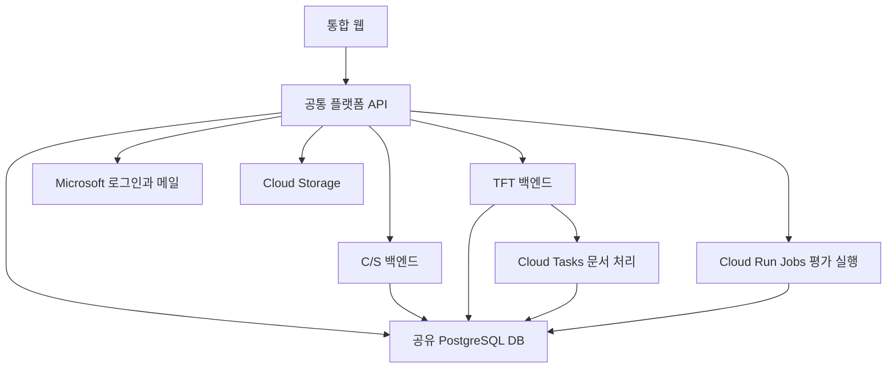

# 프로젝트 의사결정 정리

기준일: 2026년 10월 22일. 이 문서는 팀원이 현재의 기획, 기술 선택과 배포 방향을 읽고 이해하기 위한 결정 요약이다. 확정된 방향과 실제 구현 상태를 구분한다.

선택 근거는 두 종류로 구분한다. **대화 근거**는 사용자가 밝힌 목적이나 실제로 비교하고 선택한 이유다. **설계 해석**은 확정된 선택이 현재 요구에 맞는 이유를 기술적으로 설명한 것으로, 당시 발언이나 실측 결과를 대신하지 않는다. 대안은 실제 논의한 경우에만 비교 이력으로 적는다.

## 선택의 기준

우선순위는 11월 3일까지 두 업무를 통합 배포하고, 11월 10일에 사람이 확인하고 결정하는 전체 흐름을 시연하는 것이다. 팀원이 AI를 잘 활용한다는 전제는 개발 속도를 높이는 근거지만 인증, 권한과 근거 추적을 생략하는 근거는 아니다.

교육장 GCP와 Gemini를 활용해 초기 계정 및 비용 부담을 줄인다. 다만 모델 선택은 제공 여부만으로 끝내지 않고 평가 결과로 검증한다. 개발 분업을 위해 업무와 배포 경계를 나누되, 발표 후 상시 운영하지 않는 범위에 맞춰 환경 수와 중간 승인 절차는 줄인다.

이 기준에 따라 어떤 선택은 개발 독립성을, 어떤 선택은 구현 및 운영 부담 감소를 우선한다. 모든 구성 요소를 최대한 분리하는 것이 일관된 목표는 아니다.

## 목표와 일정

전력기기 제조사의 해외 C/S 문의 대응과 RFP 기반 TFT 구성을 지원한다. AI는 분석, 근거와 초안을 준비하고 사람이 발송 및 업무 결정을 확정한다.

| 항목 | 결정 |
| --- | --- |
| 개발 및 통합 배포 완료 | 2026년 11월 3일 |
| 발표 | 2026년 11월 10일 |
| 최종 목표 | 배포 환경에서 두 업무와 평가 화면을 시연 |
| 완성도 | 실제 운영할 서비스에 필요한 인증, 권한, 이력과 실패 처리를 갖추는 방향 |
| 발표 후 | 계속 운영할 계획은 없음 |
| 제출물 | 소스코드, 기획서, 발표자료 등을 분리해 제출하고 같은 최종 버전을 연결 |
| 일정 운영 | AI 활용을 전제로 개발하되 실제 진행 속도와 막힌 작업에 따라 조정 |

스프린트는 10/21~10/27 공통 기반과 평가 실행, 10/28~11/3 기능 완성과 통합 배포, 11/4~11/10 안정화와 발표 준비로 나눈다. 기존 작업의 완료 예정일과 선후관계를 유지해 앞 단계의 결과를 다음 단계에서 사용하도록 구성했다. 평가 기반을 먼저 만들고 발표 주에 새 기능을 추가하지 않기 위한 분할이다. 작업별 배정과 Jira 적용 상태는 [스프린트 계획](sprints.md)에서 관리한다.

## 서비스 범위

| 구분 | 포함하는 업무 |
| --- | --- |
| C/S 문의 대응 | 원문 문의 분석, 규칙 기반 우선순위 및 부서 배정, 근거 검색, 답변과 정보 요청 초안, 담당자 확인 후 메일 발송 |
| C/S 개선요청 | 반복 고장, 확인된 펌웨어 문제와 문서 문제 검토, 부서 요청 및 회신, 조치와 추가 발생 추적 |
| RFP 및 TFT | RFP의 과업과 필요 역할 분석, 관련 부서 후보 탐색, 부서 인력요청, 후보 추천, 경험 및 가용성 검증, 구성안과 공백 정리, 책임자 확정 |
| 공통 기능 | Microsoft 로그인, 실제 메일 읽기 및 발송, 파일과 원문 관리, 평가 실행 요청과 결과 조회 |

TFT 시연은 한 회사 내부의 부서 협업으로 구성한다. 구체적인 주관회사는 아직 선정하지 않았다. 실제 회사 시스템과의 연동, 계열사 공동 TFT의 회사 간 승인 및 자료 공유는 이번 범위에 포함하지 않는다.

C/S 문의 종결과 개선요청 완료는 별도로 관리한다. TFT도 후보 추천, 부서 검증과 최종 확정을 구분하며 일부 역할 확정을 전체 구성 완료로 처리하지 않는다.

C/S 개선 검토의 초기 기준은 일반 고장에 최근 90일 내 서로 다른 고객 3곳, 펌웨어 문제에 고객 1곳의 확인된 원인 및 적용 조건, 문서 문제에 확인된 오류 근거 1건이다. 이는 시연용 초기 정책이며 실제 도입 시 회사 데이터와 처리 여력으로 조정한다. RFP 관련 메일의 AI 분류는 후보 제시이며 프로젝트 연결과 등록은 사람이 확인한다.

| 선택 | 선택 근거 | 감수하는 제약 |
| --- | --- | --- |
| 실제 메일은 포함, 회사 시스템 연동은 제외 | 대화 근거: 메일 가져오기와 발송까지 포함하도록 지정했다. 설계 해석: 외부 시스템 접근을 기다리지 않고 문의 접수부터 사람의 확인 및 회신까지 시연할 수 있다. | ERP나 CRM과의 실제 업무 연결 및 데이터 동기화는 검증하지 못한다. |
| 한 회사 내부 TFT로 한정 | 대화 근거: 회사 내부 부서 협업으로 확정했다. 설계 해석: 요구 분석, 부서 요청, 후보 검증과 책임자 확정에 집중하고 회사 간 자료 공유 및 승인 정책은 범위에서 덜어낸다. | 계열사 공동 TFT에 그대로 적용된다고 주장할 수 없다. |
| C/S에 개선요청까지 포함 | 대화 근거: 사용자가 개선요청 포함 여부를 확인하고 확정했다. 설계 해석: 한 문의에 회신하는 업무와 반복 문제를 개선하는 업무를 모두 보여준다. | 문의 종결과 개선 완료를 별도로 추적해야 하므로 상태 관리가 늘어난다. |
| AI는 근거와 초안, 사람은 발송과 최종 결정 | 대화 근거: 두 프로젝트의 공통 기획 원칙이다. 설계 해석: 생성 결과의 불확실성을 업무 확정 권한과 분리한다. | 완전 자동 처리율보다 검토 가능한 근거와 승인 이력이 우선이다. |

개선 검토의 수치 기준은 실무 통계로 최적화한 결과가 아니다. 일반 고장은 반복성을, 펌웨어 및 문서 문제는 확인된 오류 근거를 중심으로 검토한다는 정책을 시연용 값으로 구체화한 것이다.

## 서비스 실행 구조

C/S 업무 백엔드와 TFT 업무 백엔드에 더해 공통 플랫폼 API를 독립 서비스로 배포한다. 총 세 서비스는 각각 빌드하고 배포하며, 순수 공통 코드와 데이터 계약은 패키지로 공유한다.



공통 플랫폼은 로그인과 메일, 파일, 평가 관리 API 및 브라우저의 업무 API 요청 중계를 맡는다. 실제 평가는 Cloud Run Jobs에서 실행한다. 웹 정적 파일의 구체적인 호스팅 방식은 아직 정하지 않았다.

서비스 배포는 독립적이지만 플랫폼 장애는 두 업무의 웹 접근에 영향을 준다. DB도 공유하므로 DB 장애와 자원 경합은 공통으로 영향을 준다.

| 결정 | 선택 근거 및 비교한 안 | 감수하는 제약 |
| --- | --- | --- |
| C/S와 TFT 업무 백엔드 분리 | 대화 근거: 사용자가 모듈화와 개발 분업을 이유로 업무 백엔드 두 개를 선택했다. 설계 해석: 서로 다른 업무 상태와 API 변경을 각 앱에서 다룰 수 있다. | 앱 사이의 데이터 계약과 통합 테스트가 필요하다. |
| 공통 API를 독립 서비스로 배포 | 대화 근거: 공통 기능을 C/S 앱에 함께 실행하는 초기 제안에 대해 사용자가 개발 과정의 독립성을 이유로 별도 서비스를 선택했다. 인증, 메일, 파일과 평가 API를 업무 앱의 배포 일정과 분리한다. | 세 번째 앱의 배포 및 설정, 내부 호출 인증이 추가된다. 플랫폼을 거치는 요청은 플랫폼 가용성에도 의존한다. |
| DB 인스턴스 1개와 DB 1개, 스키마 및 계정 분리 | 대화 근거: 같은 인스턴스에서 논리 DB를 나누는 안과 비교한 뒤 한 DB 구성을 선택했다. 설계 해석: 공통 사용자와 업무 자료의 연결 및 마이그레이션 관리를 단순하게 하면서 쓰기 소유권은 나눈다. | 물리적 격리가 아니므로 장애와 자원 경합을 공유한다. 스키마 이름만 나누지 말고 DB 접속 권한도 제한해야 한다. |

독립 서비스 선택과 공유 DB 선택은 서로 다른 문제를 해결한다. 전자는 개발 및 배포 경계를, 후자는 현재 규모에서 데이터 관리 부담을 조정한 결정이다. 서비스가 분리됐다는 이유로 DB까지 독립됐다고 설명하지 않는다.

## 기술 스택

| 영역 | 선택 | 설계 해석과 확인할 제약 |
| --- | --- | --- |
| 백엔드 | Python 3.11 이상, FastAPI | 규칙, 데이터 처리와 AI 호출을 같은 언어로 개발하고 API 계약으로 프론트와 분업한다. 처리량 우위를 실측해 고른 것은 아니다. |
| 프론트 | React, Vite, TypeScript, TanStack Query | 업무 및 평가 화면의 API 데이터, 로딩과 오류 상태를 일관되게 다루는 구성이다. UI 키트 없음은 확정 사항이며 특정 키트보다 우수하다는 비교 기록은 없다. |
| 실행 환경 | GCP Cloud Run, 서울 리전 | 세 FastAPI 앱을 컨테이너 단위로 독립 배포하는 요구에 맞춘다. 최소 인스턴스 1은 시연 응답성을 우선한 설정이며 유휴 비용을 감수한다. 서비스별 자원과 상한은 미정이다. |
| LLM | Gemini | 교육장 키로 시작하는 진입 부담이 낮다. 가장 정확하거나 저렴하다는 결론은 아니며 지원 목록, 품질, 지연과 비용 평가로 모델 ID를 고른다. |
| 임베딩 | Gemini 다국어 임베딩 | 다국어 원문을 직접 검색 대상으로 삼아 번역 단계를 추가하지 않는다. 언어별 검색 품질은 평가가 필요하며 모델 ID와 차원은 미정이다. |
| 검색 | PostgreSQL FTS와 pgvector | 제품 코드 및 규격 같은 키워드와 의미가 유사한 표현을 함께 찾기 위한 구성이다. 권한 필터 후 후보를 RRF로 결합하고 재정렬한다. 결합과 재정렬의 품질 이득 및 지연은 실측해야 한다. |
| DB | Cloud SQL PostgreSQL | 업무 데이터, 검색과 실행 상태를 PostgreSQL 중심으로 관리해 별도 저장소 수를 줄인다. 한 DB 안에서 서비스별 스키마와 접속 계정을 분리하며 실제 부하에서 경합을 확인해야 한다. |
| 파일 | Cloud Storage | 원문 및 첨부를 DB 행과 분리해 보관하고 인용 위치와 연결한다. 원문 판본과 파생 파일의 연결 및 변경 정책은 앱에서 구현해야 한다. |
| 인증 | Microsoft OAuth, MSAL, PKCE | 실제 메일 연동에 쓰는 Microsoft 로그인과 서비스 접근을 연결한다. 조직의 로그인 성공과 앱의 업무 권한은 별개로 검사한다. |
| 에이전트 | LangChain, LangGraph | 분류, 근거 검색, 초안과 사람의 확인을 단계 및 상태로 표현한다. 모든 단계를 별도 에이전트로 늘리는 근거는 아니며 상태 전이 검증이 필요하다. |
| 실행 상태 | langgraph-checkpoint-postgres | 실행 상태를 서비스 프로세스 밖에 보관하고 PostgreSQL 운영 구성을 재사용한다. 중단 후 재개 시 외부 작업이 중복되지 않도록 별도 검증해야 한다. |
| 추적 | LangSmith | 단계별 입력과 출력 및 실패 위치를 평가 결과와 연결하기 위한 선택이다. 요금제, 기록 범위와 민감정보 처리 정책은 미정이다. |
| 문서 비동기 처리 | Cloud Tasks | RFP OCR 및 임베딩을 API 요청 수명과 분리하고 작업 단위로 재시도하도록 설계한다. 중복 실행에도 결과가 중복 반영되지 않게 구현해야 한다. |
| 평가 및 초기화 | Cloud Run Jobs | 끝이 있는 평가 및 초기화 실행을 업무 API 프로세스와 분리한다. 실행 시작 지연과 자원 상한은 확인이 필요하다. |
| 주기 작업 | Cloud Scheduler | 메일 동기화의 주기 호출을 웹 앱 내부 타이머와 분리한다. 중복 호출과 동기화 체크포인트를 처리해야 한다. |
| CI/CD | Cloud Build, Artifact Registry | GCP 안에서 검증, 이미지 보관과 앱별 배포를 연결한다. 실행 계정 권한과 배포 트리거는 아직 구성 및 검증이 필요하다. |
| 비밀값 | Secret Manager | 키와 접속 비밀값을 코드 및 문서에 넣지 않고 실행 계정별로 제공한다. 접근 권한과 키 교체 절차는 별도 설정해야 한다. |
| 화면 진행 상황 | SSE | 서버에서 브라우저로 작업 진행 상태를 보내는 요구에 맞춘다. 재연결, 누락 이벤트 조회와 플랫폼 중계 경로의 타임아웃은 검증해야 한다. |

위 표는 [AGENTS.md](../AGENTS.md)와 현재 합의된 스택의 적용 이유를 풀어 쓴 것이다. 제품별 벤치마크나 모든 대안에 대한 비교 평가를 수행했다는 의미는 아니다.

Redis, Kubernetes, BigQuery, FAISS는 프로젝트 스택에서 사용하지 않는다. 모델 이름과 라이브러리 세부 버전은 확인 없이 임의로 고정하지 않는다.

설계 해석: 현재 요구는 PostgreSQL 중심의 업무 및 검색, 관리형 앱 배포와 유한한 비동기 작업으로 구성한다. 추가 저장소나 클러스터를 먼저 도입할 구체적인 부하 근거가 없으므로 운영 대상을 늘리지 않는다. App Engine, Cloud Functions와 Agent Platform 사용 여부도 논의했으나 현재 실행 구조에는 추가하지 않는다. 해당 제품들이 요구를 지원하지 못한다는 판단이나 성능 비교 결과를 뜻하지 않는다.

GCP와 Gemini는 교육장 제공 자원을 활용한다. 다른 분류 모델이나 임베딩 등이 필요해지면 사용자가 추가 비용을 검토한다. 제공된 모델을 기준선으로 시작하되 선택은 품질과 지연, 토큰 및 비용 평가로 검증한다. 반복 문서의 Gemini 명시적 캐시도 지원 모델 및 조건을 확인해 적용한다.

## 개발 및 배포 방향

| 항목 | 확정 내용 |
| --- | --- |
| 로컬 개발 | 팀원별 PC에서 개발 및 테스트. DB에 준비한 시연 사용자 선택 가능 |
| 공용 배포 | 교육장 GCP 프로젝트 안에 통합 테스트와 발표용 환경 한 세트 |
| 공용 환경 인증 | environment=production. 실제 Microsoft 로그인 및 권한 검사 적용, 개발용 계정 선택 차단 |
| 배포 계정 | skkuls0106@skkukdp.re.kr |
| 프로젝트 ID | proj-skkuls0106-183255377938 |
| 프로젝트 번호 | 1015616094444 |
| 리전 | asia-northeast3, 서울 |
| DB 격리 | 서비스마다 자신의 스키마만 수정. 다른 서비스는 계약된 API 또는 명시적인 최소 읽기 권한으로 접근 |

공용 환경 한 세트는 서버 한 개를 뜻하지 않는다. 세 서비스와 DB, 저장소 및 비동기 실행 구성을 묶은 팀 공용 배포 구성을 뜻한다. production은 실행 및 인증 정책이며 발표 후 계속 운영한다는 의미는 아니다.

**선택 근거:** 대화에서 팀원별 로컬 개발과 공용 시연 환경 한 세트로 확정했다. 설계 해석상 클라우드 개발, 검증 및 운영 환경을 각각 만드는 부담을 줄이고, 팀이 같은 통합 버전과 데이터로 발표를 준비하는 데 맞춘 선택이다. 대신 공용 데이터 변경과 배포가 다른 팀원의 검증에 영향을 줄 수 있고, 별도 사전 검증 환경은 없다. 배포 단위를 세 서비스로 나눴다고 환경도 세 벌 만드는 것은 아니다.

최소 인스턴스 1은 새 업무 앱의 배포 기준이다. 이전 미국 리전 rfi-web을 비용 절감을 위해 0개로 내린 뒤 사용자 요청으로 삭제한 조치는 별도 리소스 정리이며 새 기준 변경이 아니다. 유휴 비용과 응답 지연을 측정한 뒤 기준을 바꾸려면 변경 이유를 남긴다.

## 로그인과 사용자 권한

Microsoft 토큰은 서버에 보관하고 브라우저에는 세션 쿠키를 전달한다. 사용자 식별은 tid와 oid의 조합을 사용하며 이메일은 표시용이다. 로그인에 성공했다고 역할을 자동으로 부여하지 않는다. 한 사용자에게 여러 역할과 부서 및 프로젝트 범위를 지정할 수 있다.

| 역할 | 주요 업무와 범위 |
| --- | --- |
| cs_agent | 권한이 있는 C/S 문의와 개선요청 처리 |
| dept_staff | 소속 부서에 배정된 요청 회신과 후보 추천 및 검증. 부서 지정 필수 |
| sales | 담당 프로젝트의 요구 검토, 부서 인력요청 발행과 TFT 구성안 준비 |
| manager | 주관회사 전체 운영 집계 조회, 지정된 C/S 관리 부서와 TFT 관리 프로젝트의 상세 조회 및 담당자 재배정 |

관리자의 집계 조회 권한은 개인 메일함 전체나 전체 직원 자료 열람 권한으로 확대하지 않는다. 메일과 첨부, 후보 경험 자료는 접근 가능한 업무에 연결된 범위만 조회한다.

프로젝트 책임자는 새 로그인 역할이 아니다. 해당 프로젝트의 sales 또는 manager 중에서 관리 권한이 있는 manager가 지정 및 변경한다. 현재 지정된 책임자만 최종 TFT 구성안을 확정하며 변경자, 이전 및 신규 책임자, 사유와 시각을 남긴다.

| 결정 | 선택 근거 | 감수하는 제약 |
| --- | --- | --- |
| 서버 로그인과 세션 쿠키 | 대화 근거: 브라우저가 토큰을 받아 업무 API를 직접 호출하는 안과 비교해 서버 방식을 선택했다. 설계 해석: Microsoft 토큰과 메일 접근을 플랫폼에서 관리하고 브라우저의 호출 및 인증 경로를 통일한다. | 플랫폼 중계와 세션 저장, CSRF 방어 및 내부 사용자 맥락 전달을 구현해야 한다. |
| tid와 oid로 식별, DB에서 권한 관리 | 설계 해석: 표시용 이메일과 사용자 식별자를 분리하고, 로그인 여부와 회사의 업무 배정을 구분한다. 부서 및 프로젝트 범위가 다른 권한을 표현할 수 있다. | 사용자 등록과 권한 변경의 관리 주체 및 절차가 필요하다. |
| manager의 집계와 상세 조회 범위 구분 | 대화 근거: 전체 운영 현황은 보되 상세 조회 및 재배정은 지정된 관리 범위로 확정했다. 설계 해석: 업무 조정에 필요한 가시성과 원문 자료의 접근 제한을 함께 유지한다. | 전체 집계를 볼 수 있어도 개별 상세는 열 수 없는 경우를 UI와 API에서 일관되게 처리해야 한다. |
| 프로젝트 책임자는 지정 관계로 관리 | 대화 근거: 새 역할을 추가하지 않고 프로젝트별 책임자를 두기로 했다. 설계 해석: 같은 사용자가 프로젝트마다 다른 책임을 맡을 수 있고 최종 확정 주체를 명확히 남긴다. | 전역 manager라는 이유만으로 승인할 수 없으며 책임자가 없으면 확정을 막아야 한다. |

## 시연에 맞춘 TFT 업무 흐름

```text
RFP 등록과 분석
→ 담당 sales의 과업 및 역할 요구 검토
→ sales가 부서 인력요청 발행
→ 부서 담당자의 후보 추천과 경험 및 가용성 확인
→ 구성안과 공백 정리
→ 지정 책임자의 최종 확정
```

부서 인력요청 발행 전에 별도 관리자 승인을 추가하지 않는다. 같은 부서 담당자가 추천과 검증을 수행할 수 있게 하되 결과와 근거는 구분한다. 시연 범위와 핵심 권한에 영향을 주는 사항을 중심으로 결정하고 나머지는 합리적인 기본값으로 정리한다.

개발용 시연 사용자, 실제 Microsoft 로그인 사용자와 추천 후보 인력은 구분한다. 추천 후보에게 Microsoft 로그인 계정을 만들 필요는 없다. 실제 로그인과 메일 연동 가능 여부는 개발 초반에 별도 검증한다.

**선택 근거:** 사용자는 시연에서 과도하게 복잡한 절차를 피하자고 명시했다. 인력요청의 중간 승인과 추천 및 검증 담당자 강제 분리를 추가하면 계정 설정, 대기 단계와 테스트 조합이 늘어난다. 현재는 요청을 보내는 사람의 검토, 부서의 확인 근거와 지정 책임자의 최종 확정에 집중한다. 다만 같은 사람이 추천하고 확인할 수 있으므로 독립적인 교차 검증이 이뤄졌다고 설명하지 않는다.

후보 인력과 로그인 사용자를 분리하는 이유는 조직 데이터의 모든 사람을 앱 사용자로 만들 필요가 없기 때문이다. 로컬 계정 선택은 개발을 앞당기는 수단이며 실제 Microsoft 로그인과 Graph 메일 연동이 된다는 증거는 아니다.

## 조직 자료와 실데이터 교체

공개 자료에 나온 회사 및 조직, RFP의 업무 분야, 프로젝트에서 필요한 역할과 서비스 로그인 권한을 분리한다. 설계, 토목/구조, 시공/운송, 품질/시험, 사업관리는 업무 분류이며 실제 부서명이나 로그인 역할을 대신하지 않는다.

공개 조직 자료는 관련 부서 후보를 찾는 근거로 활용한다. 개인의 경험과 가용성은 시연용 가상 자료 및 담당자 확인으로 준비한다. 자료에서 확인하지 못한 내부 조직과 경력을 AI가 만들어 채우지 않는다.

원천 데이터 어댑터가 CSV, 업로드와 메일을 공통 업무 모델로 변환한다. 실제 회사 데이터를 받으면 어댑터와 정책, 권한, 평가 사례를 교체 및 검증하는 구조로 설명한다. 가상 자료와 실제 자료의 출처 및 확인 시점도 구분한다.

**선택 근거:** 대화에서 사용자가 가정한 데이터를 쓰더라도 실제 현업 데이터를 받으면 인터페이스로 교체할 수 있음을 설명하고 싶다고 요청했다. 따라서 원본 필드와 형식에 업무 코드를 직접 묶지 않고 공통 모델로 변환하는 경계를 둔다. 공개 조직명, 업무 분류와 로그인 권한도 분리해 자료 교체가 곧 권한 변경이 되지 않게 한다.

이는 교체할 위치를 정한 설계이며 실제 회사 데이터의 무수정 적용을 검증한 결과는 아니다. 필드 의미, 식별자, 권한, 정책과 평가 사례를 맞추는 도입 작업은 남는다.

## 평가와 품질

모델을 먼저 고정하기보다 비교 가능한 평가 파이프라인을 먼저 구축한다. 화면에서 실행 설정, 진행 상태, 모델별 비교와 사례별 결과를 확인할 수 있게 한다. LLM, 임베딩, OCR과 재정렬 구현을 교체할 수 있는 인터페이스를 둔다.

품질뿐 아니라 토큰, 비용, 지연, 재시도, 오류와 캐시 사용을 실행별로 기록한다. 데이터셋과 설정, 프롬프트 및 모델 판본을 보존해 비교 조건을 맞춘다.

**선택 근거:** 사용자는 모델을 바꾸며 성능과 토큰 비용을 비교해 의사결정하고, 그 과정을 화면에서도 확인하고 싶다고 요청했다. 평가를 마지막 검수에만 두지 않고 모델 선택의 선행 조건으로 삼은 이유다. 화면은 실행과 실패 사례를 함께 검토하기 위한 도구이며 점수만 높게 표시하는 발표용 결과판이 아니다.

대신 평가 데이터 정리, 실행 기록과 비교 화면을 먼저 만드는 비용을 감수한다. 같은 모델이라도 프롬프트, 데이터와 재시도 조건이 다르면 결과를 단순 비교하지 않는다. 아직 측정하지 않은 품질 개선이나 비용 절감 수치를 선택 근거로 사용하지 않는다.

| C/S 지표 | 확정 합격선 |
| --- | --- |
| 문의 유형 macro-F1 | 0.90 이상 |
| CRITICAL 누락 | SAFETY 및 SITE_DOWN 누락 0건 |
| 우선순위 | adjusted=N 부분집합에서 1.0000 |
| 긴급도 | macro-F1 0.70 이상, 비NONE 재현율 0.85 이상 |
| 담당부서 | 0.93 이상 |
| 출력 스키마 위반율 | 0 |

위 수치는 목표 기준이며 이번 세션에서 달성한 측정 결과가 아니다. TFT, OCR, 검색과 생성 초안의 합격선 및 부하 조건은 별도 확정이 필요하다. 최종 시험 자료를 반복 튜닝에 사용하지 않으며 사용 및 노출 이력을 확인한다.

규칙으로 결정되는 priority, assigned_dept와 product_family는 LLM에 맡기지 않는다. 설계 근거는 같은 입력의 결과를 재현하고 정책 변경과 모델 오류를 분리하기 위해서다. 문의 분류 LLM 출력은 category_code, urgency_flag, provided_info와 return_subtype 네 개이며 입력 화이트리스트는 build_input() 한 곳에서 관리한다.

안전 관련 CRITICAL 누락 0건과 FLT-042 인용 차단은 평균 점수로 상쇄하지 않는 기준이다. PHONE 채널의 긴급도 정답 누설과 SAFETY 표본 부족을 분리해 보고하고, test 597건은 2회 이상 사용하지 않는다. 합격선만 넘었다고 실제 현업 전체에서의 안전성과 성능이 입증됐다고 표현하지 않는다.

## 결정을 다시 검토할 조건

아래는 현재 범위를 늘리는 요구사항이 아니라, 이후 선택을 바꿀 때 확인할 근거다.

| 현재 선택 | 재검토할 조건 |
| --- | --- |
| 독립 플랫폼과 공유 DB | 공통 배포가 반복적으로 업무 개발을 막거나 DB 자원 경합 및 권한 격리 요구가 현재 구조로 해결되지 않을 때 |
| 로컬 개발과 공용 환경 한 세트 | 공용 배포와 데이터 변경이 검증을 반복해서 방해하거나 실제 운영에서 별도 검증 및 복구 환경이 필요해질 때 |
| Cloud Run 및 최소 인스턴스 1 | 실측 지연, 동시 처리량과 유휴 비용이 목표에 맞지 않을 때. 먼저 자원 및 상한 조정으로 해결되는지 확인 |
| Gemini 및 현재 검색 구성 | 합격선을 충족하지 못하거나 대안이 같은 조건에서 품질, 지연 및 비용 면에서 더 적합하다는 평가 결과가 있을 때 |
| 단일 회사 및 간소화한 승인 흐름 | 회사 간 자료 공유를 포함하거나 실제 조직 정책이 독립 검증 및 추가 승인 단계를 요구할 때 |
| 시연용 데이터와 초기 정책 | 실제 데이터의 필드 의미, 분포와 처리 여력이 현재 가정과 달라 재평가가 필요할 때 |

결정을 바꿀 때는 바뀐 요구나 측정 결과, 선택한 대안, 영향받는 API 및 데이터 계약과 일정까지 함께 기록한다.

## 현재 설정과 미완료 사항

| 상태 | 내용 |
| --- | --- |
| 확인 완료 | 교육장 프로젝트 선택, 계정 재로그인, 결제 연결, 프로젝트 owner 및 editor 역할 |
| 확인 완료 | Cloud Tasks 및 Cloud Build API 활성화 |
| 확인 완료 | cs-runtime, tft-runtime, platform-runtime 활성 및 roles/cloudsql.client 부여. 검증 Jobs에서 실제 DB 연결 성공 |
| 삭제 완료 | 이전 미국 리전 rfi-web, rfi-db, 이미지 저장소, 수집 Job과 Scheduler, cloud-database-url Secret. 2026-10-21 11:52 UTC 잔여 목록 재조회 |
| 보존 만료 대기 | RFI 버킷 및 객체 전체 버전 삭제 명령은 성공했으나 11:55 UTC Storage API에서 soft-deleted 버킷 1개 확인. 2026-10-28 20:51:25 KST 영구 삭제 예정 |
| 보존 | gemini-api-key Secret, 교육장 프로젝트와 결제 연결, 활성 API와 실행 서비스 계정. 로컬 data는 변경하지 않음 |
| 생성 확인 | 2026-10-21 12:18 UTC, 서울 `team4-sql` RUNNABLE. PostgreSQL 17 Enterprise, 2 vCPU 및 8GiB, SSD 20GB, ZONAL. Connector 강제, 일일 백업 7개 및 삭제 보호 활성. 세부 실조회는 infra-preflight.md 참고 |
| 사용자 확인 | 업무 DB team4, 앱 계정 3개와 서비스별 권한 SQL 적용, 검증 PASS 및 실제 로그인과 스키마 접근 행렬 확인. DB 및 앱 계정 존재는 API 재조회, 상세 SQL 및 로그인 결과는 사용자 실행 보고 |
| 생성 및 권한 확인 | 서울 Docker 저장소 team4와 비공개 파일 버킷 생성. 플랫폼 실행 계정에 해당 버킷 roles/storage.objectUser 부여. 12:45 UTC 실조회 |
| 등록 확인 | DB Secret 3개, 서울 복제 위치, 활성 버전 1 및 대응 실행 계정의 Secret 수준 접근 권한. 12:51 UTC 실조회 |
| 실제 연결 검증 | 12:57 UTC Cloud Run 검증 Jobs 3개 성공. 각 실행 계정의 Secret 버전 1 전달 및 대응 DB 사용자 접속을 실행 상태와 로그로 확인 |
| 생성 및 권한 확인 | 서울 rfp-document-processing 큐 RUNNING, 동시 2건 및 전송률 2/s, 최대 시도 5회와 TFT 실행 계정의 큐 수준 enqueuer 권한. 13:00 UTC 실조회 |
| 로컬 구현 및 검증 | 세 FastAPI 실행 골격, health와 공통 응답 및 오류, production 보호, 앱별 health OpenAPI와 Docker 이미지. 테스트 18건 및 Docker HTTP 검증 통과 |
| 준비 및 미실행 | cloudbuild.yaml의 테스트 및 이미지 3개 빌드 설정. 실제 Cloud Build 실행, 이미지 업로드와 서비스 배포는 남음 |
| 미완료 | 처리 API URL 및 OIDC 연결, 공유 search 및 runtime 정책, 업무 테이블과 전체 CI/CD |
| 미완료 | 실제 Microsoft 로그인 및 메일, Gemini 모델 지원 목록과 호출 제약 검증 |
| 미완료 | 앱별 OpenAPI, 마이그레이션과 권한 테스트. 기존 API 및 데이터 계약 문서는 검토 초안 |

사용자는 기존 RFI 리소스 삭제를 요청한 뒤, DB 최종 백업을 만들지 않고 버킷의 7일 복구 보존을 해제해 모든 파일을 삭제하는 범위에 대해 **백업 없이 완전 삭제**를 명시적으로 선택했다. DB 인스턴스와 프로젝트 백업 목록, 일반 버킷 및 이미지 저장소 목록이 비어 있음을 확인했다. 다만 soft-deleted 버킷이 남아 있어 전체 원본의 영구 삭제 완료로 보고하지 않는다. 보존 만료 전 강제 영구 삭제는 Google 정책상 지원하지 않는다. 새 API 및 데이터 계약과 개발 일정 변경은 없으며, 다음 작업은 서울 신규 환경 구성이다.

이전 DB는 최종 백업 없이 삭제됐지만 GCS 복구 보존과 gemini-api-key Secret은 남아 있고 실제 누적 청구액은 확인하지 못했다. 프로젝트 전체 비용이 0원이라고 단정하지 않는다. 자세한 확인 결과는 [비용 점검 기록](gcp-cost-audit.md)을 참고한다.

남은 주요 결정은 시연 주관회사, DB 인증과 접속 권한의 세부 구현, 웹 호스팅 및 내부 호출 인증의 구체 설정, 모델 ID와 임베딩 차원, 평가 및 계정 관리 권한, LangSmith 요금제다. DB 사양과 공인 IP 및 Connector 연결은 위 설정으로 생성했으며 실제 부하와 연결 검증은 남아 있다.

## 담당과 문서 관리

2026-10-21 후속 사용자 결정: 현재 초기 셋업은 PR 없이 main에 직접 push한다. 티켓별 커밋과 검증 결과는 유지하고 기존 셋업 Draft PR은 정리한다. 개발 시작에 필요한 기반을 즉시 공유하려는 선택이며 이후 업무 기능 개발의 PR 및 검토 규칙 전체를 없애는 결정은 아니다.

2026-10-21 사용자는 "지금 셋업하는건 동료 검토 생략할거야"라고 결정했다. 현재 계약 초안 및 GitHub 자동화, 실행 골격, DB와 GCP, 빌드 및 비동기 기반의 초기 셋업은 동료 검토와 승인 대기 없이 진행한다. 적용 티켓은 KAN-55/56/60/62/63/65/66/67/69의 현재 셋업 범위이며 이후 업무 기능 개발에 대한 일반 면제는 아니다. 기존 담당과 검토자 배정 이력은 유지하며, 해당 셋업의 완료 판정에서 동료 검토는 요구하지 않는다. 테스트, 실제 실행 검증과 미구현 완료 조건은 계속 확인한다.

| WBS 구분 | 담당자 | 기존 담당 범위 |
| --- | --- | --- |
| A | 김나영 | 인프라, 인증, 메일, C/S API 및 규칙 |
| B | 오새결 | 데이터, 검색, AI 및 평가 |
| C | 김종하 | 프론트, TFT 백엔드 및 평가 관리 API |

2026-10-21 사용자 요청으로 실제 수행한 현재 셋업의 Jira KAN-55/56/60/62/63/65/66/67/69 담당자를 오새결로 변경하고 재조회로 확인했다. 해당 티켓의 이전 담당 유지 기록보다 이 최신 결정이 우선한다. 위 표는 기존 WBS 분담 이력이며 WBS 원본은 이번에 변경하지 않았다. 현재 셋업은 동료 검토를 생략한다. 최신 공통 플랫폼 분리와 평가 관리 API의 배치는 기존 담당 범위에 대한 구체적인 구현 분담과 별도로 조율한다.

기획 원본은 Google Docs, 일정과 작업은 WBS 및 Jira, 구현과 개발 계약은 코드 저장소에서 관리한다. 이번 세션에서 조회한 일부 원본에는 이전 견적 범위와 기술 후보가 남아 있어 이번 결정과 맞추는 작업이 필요했다. 원본 정합화 시 최신 판본을 다시 확인한다.

- [현재 WBS](https://docs.google.com/spreadsheets/d/11X85xRDncd_xg3EPhcoke6dhF1fhTByKzhpRxLk6ow8/edit#gid=1680447802)
- [Jira KAN 보드](https://lsteam4.atlassian.net/jira/software/projects/KAN/boards/1)
- [C/S 기획 원본](https://docs.google.com/document/d/1DhnpC5vyPEIhk3QJ3IRSTLX5f-U-HfpRMdCaGDVnGpg/edit)
- [RFP 기획 원본](https://docs.google.com/document/d/1Zz_ps2r9oRM5wTt75L-RboCc1knqJ1WYGZZ9DZc09fQ/edit)
- [조직 조사 자료 폴더](https://drive.google.com/drive/folders/1LK1Qa6bFtsBwChqV3vt_P4V1KLP9rEau)
- [개발 아키텍처 상세](architecture.md)
- [데이터 계약 초안](data-contract.md)
- [API 계약 초안](api-contract.md)
- [다음 세션 인수인계](../handoff.md)

## 2026-10-22 개발 시작 환경과 계약 변경 방식

대화 근거: 사용자는 팀원이 안내를 보고 바로 실행할 수 있고, 개발 중 API 계약을 자주 바꾸더라도 충돌을 최소화하도록 요청했다. 구현 방식은 이 요구를 충족하기 위한 설계 선택이다.

각 서비스의 기능별 Pydantic 모델과 라우터를 계약 원본으로 삼고 서비스별 OpenAPI 및 합성 예시만 생성한다. TypeScript 생성물은 Git에서 제외하고 설치와 CI에서 다시 만든다. 수작업 DTO와 타입의 중복을 줄이고 C/S 수정이 TFT 계약 파일까지 바꾸지 않도록 하기 위함이다. 공통 HTTP 형식은 작게 유지한다. 필드 삭제 및 필수화 같은 변경은 소비자와 함께 수정해야 하며, 생성 파일 분리가 의미적 호환성을 보장하지는 않는다.

로컬에서는 Docker Compose로 pgvector가 있는 PostgreSQL과 독립 앱 3개를 실행한다. 각 PC에 서로 다른 로컬 비밀번호와 합성 사용자를 생성하고 실제 DB 세션을 사용한다. 외부 키와 원본 데이터 없이 시작할 수 있으며 production의 Microsoft 인증을 대체하지 않는다. API 목록은 구현 전 501로 표시하고 합성 응답은 개발 프론트에서만 선택한다. 프론트 연결 확인 화면은 기존 프로토타입과 별도다.

평가 연결 점검은 합성 2건의 JSON 및 HTML 기록부터 제공한다. 실제 업무 합격선, 최종 test와 모델 비교 실험을 수행한 것으로 해석하지 않는다. 실제 생성 API의 404 및 429를 기록했으며, 목록 조회와 임베딩 성공만으로 생성 모델을 확정하지 않는다.

## 2026-10-22 서비스별 CI와 CD 및 공용 웹 최소 범위

대화 근거: 사용자는 모노레포에서도 프론트와 각 백엔드의 CI 및 CD가 분리되기를 요청했고, 공용 웹 및 외부 연동 검증과 최소 운영 점검까지 먼저 진행하기로 했다.

변경 경로와 공유 코드 영향으로 검사를 고르고, 실제 배포 버전과 비교해 서비스별 이미지만 빌드 및 배포한다. API 계약 변경은 프론트 타입 호환성을 검사하되 웹 실행 코드가 바뀌지 않으면 웹 이미지를 배포하지 않는다. 실패 CI 뒤 문서 커밋으로 검사가 생략되거나 중간 커밋이 배포에서 누락되지 않도록 마지막 성공 CI와 서비스별 배포 SHA를 기준으로 비교한다. 선택 로직이 공유 의존성을 빠뜨리지 않도록 새 공유 모듈 추가 시 영향 규칙도 갱신해야 한다.

공용 프론트는 Cloud Run의 별도 web 서비스와 Node 24 정적 서버로 준비한다. 이번에는 업무 기능 대신 플랫폼 health 및 ready만 IAM으로 중계한다. Microsoft 사용자 인증 전 업무 API를 그대로 노출하지 않고 최소 연결만 확인하기 위함이다. 제품의 전체 세션 및 BFF는 후속 구현이다.

GitHub는 키 파일 대신 저장소 ID, main과 배포 워크플로 경로로 제한한 OIDC를 사용한다. 이미지 생성과 Cloud Run 배포 계정을 분리하고, 자동 CD는 기존 공개 정책을 유지할 수 있는 권한만 가진다. 첫 웹의 공개 설정은 사용자가 초기 배포 때 적용하고 검증 후 자동 CD를 활성화한다. 자동 CD 트리거의 실제 성공 여부는 별도 실행 기록을 따른다.
